# TraceRCA AI

**Distributed OpenTelemetry Multi-Layer Causal Inference & Auto-Healing Engine**

TraceRCA AI is an observability and root-cause-analysis (RCA) platform for distributed, microservice-based systems. It connects traces, logs, metrics, and service topology into a unified evidence chain so that the *actual* cause of a failure can be found, explained, and safely remediated.

---

## Table of Contents

- [Overview](#overview)
- [Key Capabilities](#key-capabilities)
- [Project Vision](#project-vision)
- [Architecture](#architecture)
- [Project Status](#project-status)
- [Telemetry Ingestion API](#telemetry-ingestion-api)
- [OpenTelemetry Integration](#opentelemetry-integration)
- [Database Schema Evolution](#database-schema-evolution)
- [Telemetry Normalization](#telemetry-normalization)
- [Telemetry Correlation](#telemetry-correlation)
- [Service Topology + Neo4j](#service-topology--neo4j)
- [Basic Anomaly Detection](#basic-anomaly-detection)
- [Dashboard](#dashboard)
- [Part 1 Final Verification](#part-1-final-verification)
- [Project Structure](#project-structure)
- [Getting Started](#getting-started)
- [Testing](#testing)

---

## Overview

Modern systems can contain dozens or hundreds of interconnected services. When a failure occurs, the visible error is rarely the real cause. TraceRCA AI answers the full chain of incident questions:

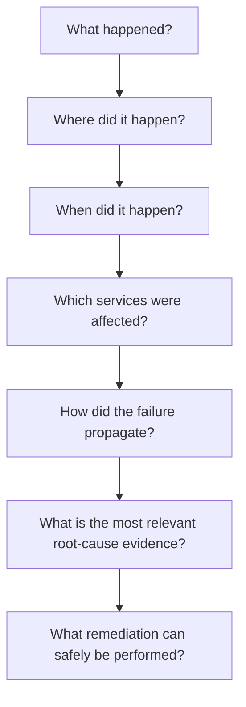

## Key Capabilities

| Area | Capability |
|---|---|
| **Telemetry** | OpenTelemetry traces, application logs, infrastructure metrics |
| **Context** | Service metadata, service dependency graphs, deployment and configuration changes |
| **Correlation** | Incident and alert correlation, temporal dependency analysis |
| **Intelligence** | Causal inference, Graph RAG, evidence-based root-cause analysis |
| **Impact** | Blast-radius analysis |
| **Action** | Remediation recommendations, controlled auto-healing |

---

## Project Vision

A single user request can traverse many components:

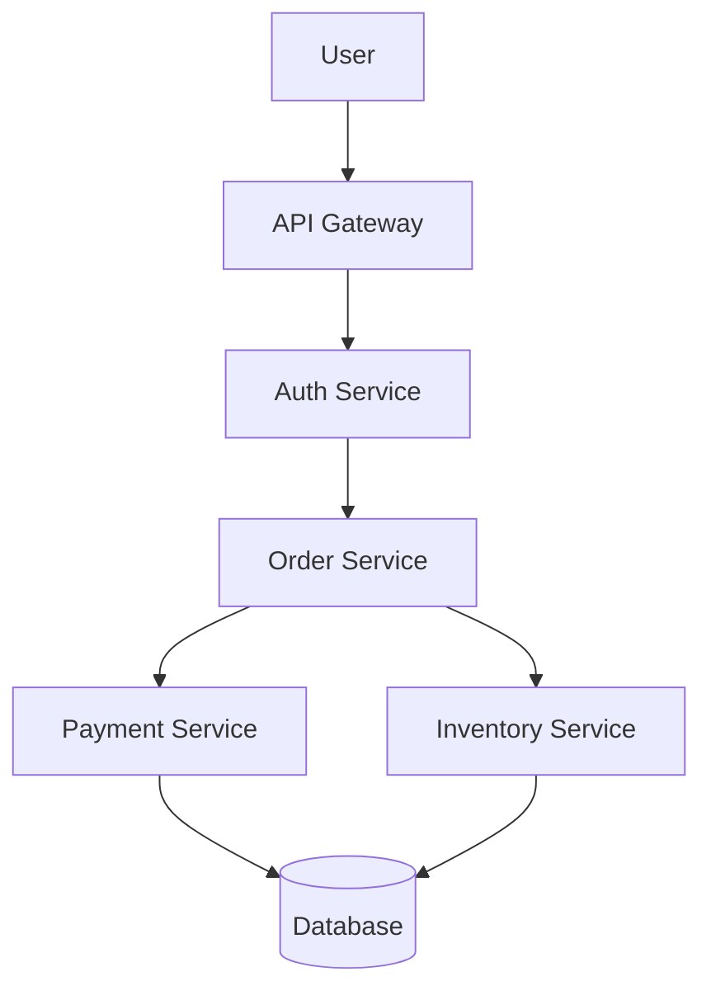

When a failure occurs, the visible symptom may sit far from the underlying cause:

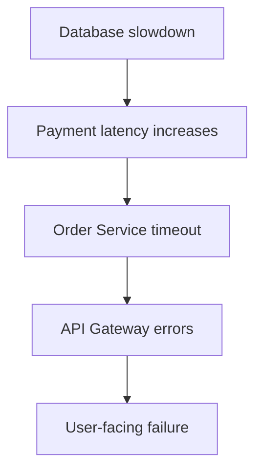

Traditional monitoring shows each signal in isolation. TraceRCA AI connects them and preserves the relationships required for deeper analysis.

### Core Problem

Distributed systems produce many kinds of operational data:

- Distributed traces
- Application logs
- Infrastructure metrics
- Service metadata and dependency relationships
- Alerts and incident information
- Deployment and configuration changes

The challenge is not collecting this data — it is **understanding** it: correlating signals across services and time to find the root cause and decide what can be fixed safely.

---

## Architecture

The project is delivered in three parts:

| Part | Name | Focus |
|---|---|---|
| **Part 1** | Observability Foundation | Ingest, normalize, and correlate telemetry; build service topology; detect anomalies |
| **Part 2** | AI Root Cause Intelligence | Causal inference, Graph RAG, evidence-based RCA, blast-radius analysis |
| **Part 3** | Auto-Healing & Production | Remediation recommendations, controlled auto-healing, production hardening |

### Part 1 — Observability Foundation

Part 1 produces reliable, structured information for the AI intelligence layer to consume.

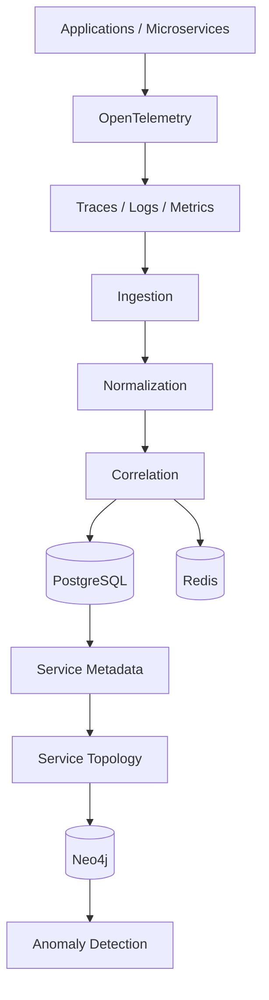

**Expected output of Part 1:** Telemetry → Normalized Events → Correlated Events → Service Topology → Anomalies.

---

## Project Status

**Part 1 (Observability Foundation) is complete.**

| Part | Status |
|---|---|
| Part 1 — Observability Foundation | ✅ Complete — ingestion, normalization, correlation, service topology, and anomaly detection |
| Part 2 — AI Root Cause Intelligence | ⏳ Planned |
| Part 3 — Auto-Healing & Production | ⏳ Planned |

### Part 1 Workstreams

| Workstream | Status |
|---|---|
| Telemetry Ingestion API | ✅ Complete |
| OpenTelemetry Integration | ✅ Complete |
| Database Schema Evolution (trace fields) | ✅ Complete |
| Telemetry Normalization | ✅ Complete |
| Telemetry Correlation | ✅ Complete |
| Service Topology + Neo4j | ✅ Complete |
| Basic Anomaly Detection | ✅ Complete |
| Dashboard | 🔄 In progress — architecture, API contracts, and topology view verified |

---

## Telemetry Ingestion API

The Telemetry Ingestion API is the entry point for telemetry from OpenTelemetry-enabled services. It validates incoming data, converts it into the internal `TelemetryEvent` model, and persists it to PostgreSQL.

**Status:** ✅ Complete

### Endpoints

| Method | Endpoint | Purpose |
|---|---|---|
| `POST` | `/telemetry/traces` | Ingest trace spans |
| `POST` | `/telemetry/logs` | Ingest application logs |
| `POST` | `/telemetry/metrics` | Ingest infrastructure metrics |

### Request Flow

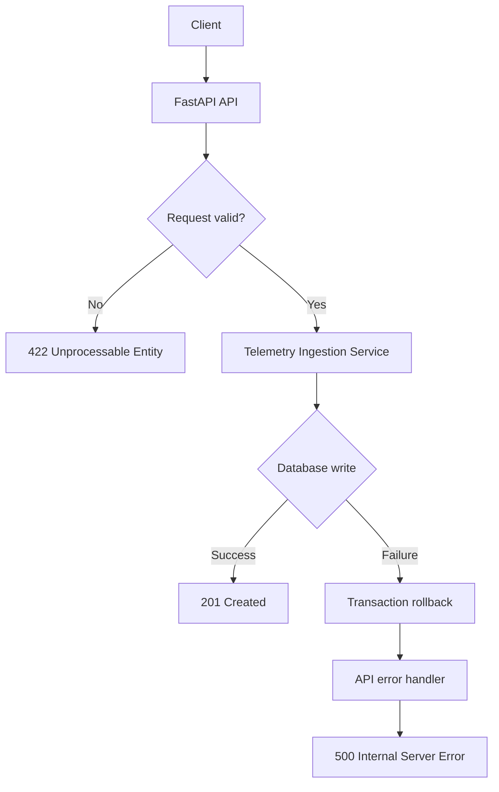

### Validation Rules

Validation is enforced with Pydantic. Whitespace-only values are rejected for important string fields, maximum lengths are enforced on identifiers and messages, and flexible OpenTelemetry attributes are preserved.

| Signal | Rules |
|---|---|
| **Traces** | `trace_id`, `span_id`, `service_name`, `operation_name` must be non-empty; optional parent span ID has a maximum length; `duration_ms` must not be negative; `status` must be `UNSET`, `OK`, or `ERROR` |
| **Logs** | `service_name` and `message` must be non-empty; maximum message length; timestamp must be valid |
| **Metrics** | `service_name` and `metric_name` must be non-empty and valid; `metric_value` must be numeric; timestamp must be valid |

Invalid requests return `422 Unprocessable Entity`.

### Error Handling

The ingestion service handles SQLAlchemy errors and OS/database connection errors. On failure it:

1. Rolls back the active transaction so no partial writes remain.
2. Re-raises the original exception.
3. Lets the API layer translate it into a consistent client response without exposing internal database details.

All three endpoints return the same structure on persistence failure:

```http
HTTP/1.1 500 Internal Server Error
```

```json
{
  "detail": "Failed to persist telemetry event"
}
```

| Scenario | Status Code |
|---|---|
| Event stored successfully | `201 Created` |
| Invalid request payload | `422 Unprocessable Entity` |
| Database / persistence failure | `500 Internal Server Error` |

### Testing & Verification

Coverage includes trace, log, and metric persistence; successful and invalid API requests for all three telemetry types; and database failure / transaction rollback handling.

```bash
pytest -q tests/test_ingestion_service.py tests/test_telemetry_api.py
```

**16 tests passed** — schema validation works for traces, logs, and metrics; database errors are handled and rolled back at the service layer; all endpoints return a consistent `500` on persistence failure; existing ingestion functionality is unaffected.

---

## OpenTelemetry Integration

**Status:** ✅ Complete

This verifies the complete telemetry flow from an OpenTelemetry span through to PostgreSQL, using the real ingestion service and a real database rather than mocking persistence.

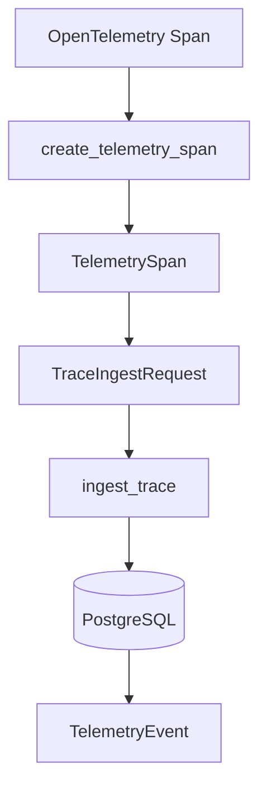

### Verification

| Test Run | Result |
|---|---|
| Full project test suite | 28 passed |
| OpenTelemetry integration test (standalone) | 1 passed |
| Existing OpenTelemetry tests + integration test | 3 passed |

### Output

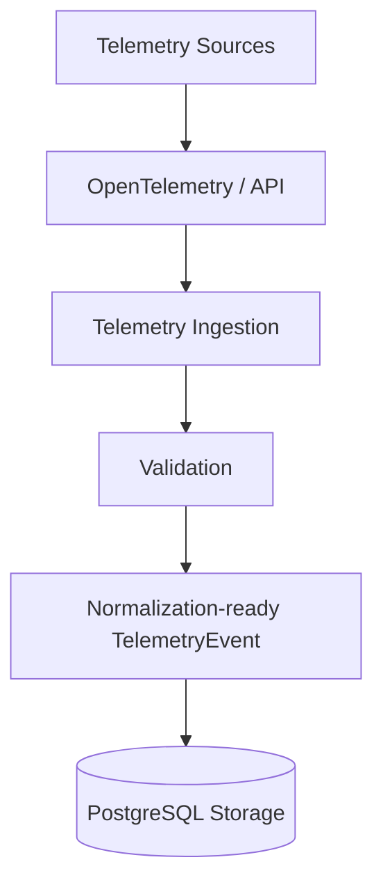

This output feeds the telemetry normalization layer:

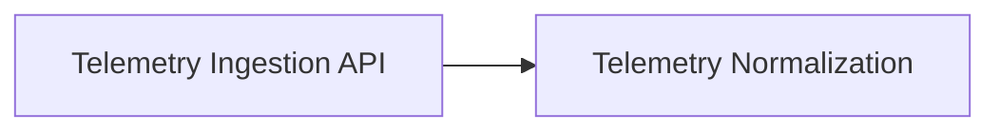

---

## Database Schema Evolution

**Status:** ✅ Complete

Inspected the telemetry data produced by ingestion and compared the ingestion schemas, SQLAlchemy models, and the actual PostgreSQL table structure.

### Findings

The `telemetry_events` table already stored:

`event_type`, `timestamp`, `service_name`, `trace_id`, `span_id`, `parent_span_id`, `message`, `metric_name`, `metric_value`, `attributes`, `created_at`

However, the trace ingestion schema accepted three fields that were **not** being persisted:

- `operation_name`
- `duration_ms`
- `status`

These matter for the RCA pipeline because:

| Field | Why It Matters |
|---|---|
| `operation_name` | Identifies the failing or slow operation |
| `duration_ms` | Enables latency and performance analysis |
| `status` | Enables error/failure detection |

### Schema Update

The `TelemetryEvent` SQLAlchemy model was updated with:

```text
operation_name  VARCHAR(255)
duration_ms     FLOAT
status          VARCHAR(50)
```

### Migration

An Alembic migration was generated and applied:

```text
ce12331ef2cd → c0ebede2393f_add_trace_fields_to_telemetry_events.py
```

PostgreSQL verification confirmed the three new columns are present on `telemetry_events`. Existing log and metric records correctly show the new fields as `NULL` for historical rows created before the schema update.

### Trace Ingestion Update

The trace ingestion service was updated to persist `operation_name`, `duration_ms`, and `status` on new trace events.

```bash
pytest -q tests/test_ingestion_service.py tests/test_telemetry_integration.py
```

**7 tests passed** — the updated trace ingestion service correctly persists the new fields; existing log and metric ingestion is unaffected; an OpenTelemetry trace flows end-to-end through the ingestion pipeline into PostgreSQL.

---

## Telemetry Normalization

**Status:** ✅ Complete

### Why Normalization Matters

Telemetry arrives in three different shapes:

```text
Trace:  service_name, operation_name, duration_ms, status, trace_id
Log:    service_name, message, trace_id
Metric: service_name, metric_name, metric_value
```

If sent directly to the RCA engine, it must understand three different formats. Normalization converts all three into one common structure before anything downstream sees them:

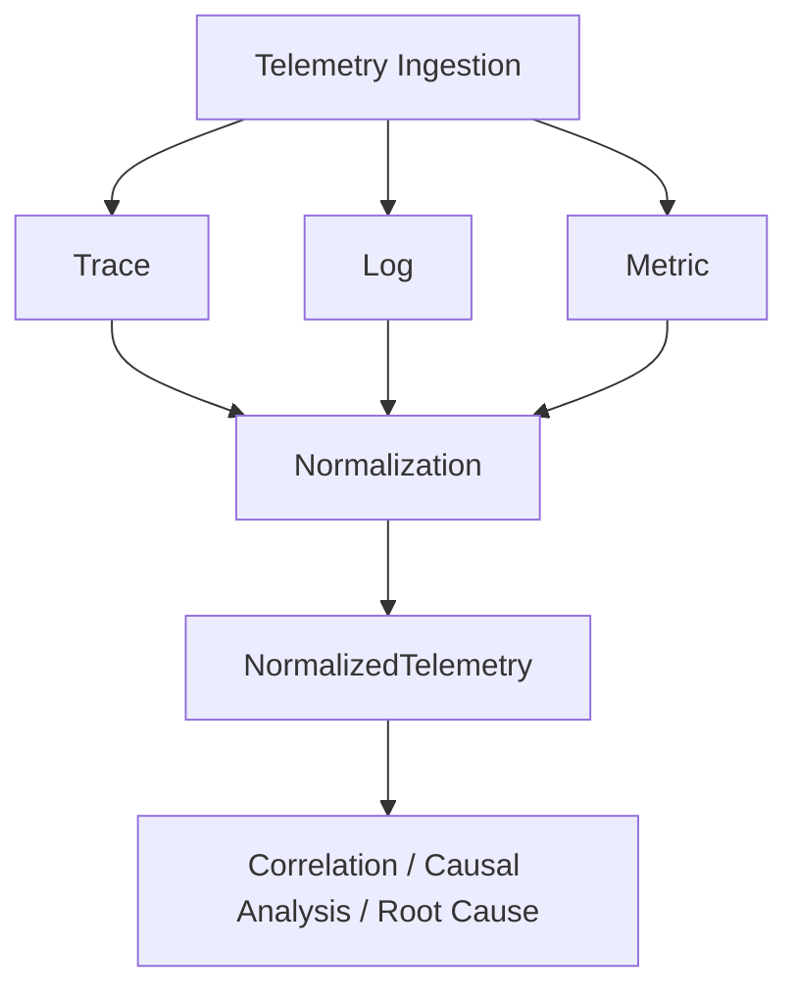

> **Normalization** = converting different telemetry formats into one common language so the rest of TraceRCA can analyze traces, logs, and metrics together.

Raw ingestion schemas are preserved as the input boundary; normalization sits as a layer after them:

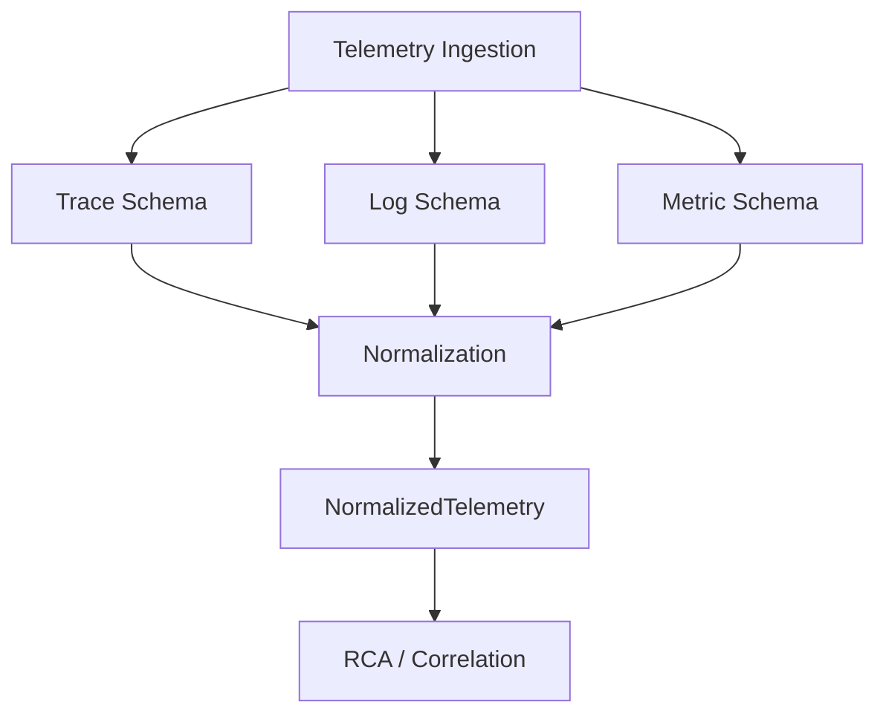

### Normalized Telemetry Schema

A single common schema was designed rather than three separate normalized schemas:

```text
                  NormalizedTelemetry
                 /         |          \
             Trace        Log        Metric
```

| Field | Type | Required | Used By |
|---|---|---|---|
| `event_id` | UUID | ✅ | all |
| `event_type` | `trace` / `log` / `metric` | ✅ | all |
| `timestamp` | datetime | ✅ | all |
| `service_name` | string | ✅ | all |
| `operation_name` | string \| None | — | trace |
| `trace_id` | string \| None | — | trace, log |
| `span_id` | string \| None | — | trace, log |
| `parent_span_id` | string \| None | — | trace |
| `duration_ms` | float \| None | — | trace |
| `status` | `UNSET`/`OK`/`ERROR` \| None | — | trace |
| `message` | string \| None | — | log |
| `metric_name` | string \| None | — | metric |
| `metric_value` | float \| None | — | metric |
| `attributes` | `dict[str, Any]` | ✅ | all |

**Validation rules:**

- `event_type` must be `trace`, `log`, or `metric`
- `service_name` is required and cannot be empty or whitespace-only
- `duration_ms` cannot be negative
- `status` must be `UNSET`, `OK`, or `ERROR`
- `message` cannot be empty if provided
- `metric_name` has string length limits
- Identifier fields are optional strings with length limits
- `attributes` must be a dictionary

```bash
pytest -q
```

**9 tests passed** — valid `NormalizedTelemetry` objects are accepted; invalid `event_type`, negative `duration_ms`, empty `service_name`, invalid `status`, and empty `message` are all rejected; trace, log, and metric telemetry all fit the common schema.

### Trace Normalization

**Status:** ✅ Complete

| Source Field (`TelemetryEvent`) | Normalized Field |
|---|---|
| `id` | `event_id` |
| `event_type` | `event_type` |
| `timestamp` | `timestamp` |
| `service_name` | `service_name` |
| `operation_name` | `operation_name` |
| `trace_id` | `trace_id` |
| `span_id` | `span_id` |
| `parent_span_id` | `parent_span_id` |
| `duration_ms` | `duration_ms` |
| `status` | `status` |
| `attributes` | `attributes` |

`message`, `metric_name`, and `metric_value` remain `None` for trace events.

```python
NormalizedTelemetry(
    event_type="trace",
    service_name="payment-service",
    operation_name="process-payment",
    duration_ms=245.5,
    status="ERROR",
    trace_id="abc123",
    span_id="span456",
)
```

A guard prevents other event types from reaching the trace normalizer:

```python
if event.event_type != "trace":
    raise ValueError("Expected a trace telemetry event")
```

```bash
pytest -q tests/test_trace_normalizer.py tests/test_normalized_telemetry.py
```

**13 tests passed** — trace telemetry is correctly transformed from the persisted `TelemetryEvent` into `NormalizedTelemetry`; all trace fields are preserved; non-trace events are rejected; missing optional fields and attributes are handled safely.

### Log Normalization

**Status:** ✅ Complete

| Source Field (`TelemetryEvent`) | Normalized Field |
|---|---|
| `id` | `event_id` |
| `event_type` | `event_type` |
| `timestamp` | `timestamp` |
| `service_name` | `service_name` |
| `trace_id` | `trace_id` |
| `span_id` | `span_id` |
| `message` | `message` |
| `attributes` | `attributes` |

`operation_name`, `parent_span_id`, `duration_ms`, `status`, `metric_name`, and `metric_value` remain `None` for log events.

```python
NormalizedTelemetry(
    event_type="log",
    service_name="payment-service",
    message="Database connection failed",
    trace_id="abc123",
    span_id="span456",
    attributes={"level": "ERROR"},
)
```

Edge cases tested: logs without `trace_id`, without `span_id`, and with `attributes=None` (normalizes to `{}`).

```bash
pytest -q tests/test_log_normalizer.py
```

**2 tests passed** — log telemetry normalizes correctly with optional fields and missing attributes handled safely.

### Metric Normalization

**Status:** ✅ Complete

Converts persisted `TelemetryEvent` metric records into the common `NormalizedTelemetry` representation.

| Source Field (`TelemetryEvent`) | Normalized Field |
|---|---|
| `id` | `event_id` |
| `event_type` | `event_type` |
| `timestamp` | `timestamp` |
| `service_name` | `service_name` |
| `metric_name` | `metric_name` |
| `metric_value` | `metric_value` |
| `attributes` | `attributes` |

`operation_name`, `trace_id`, `span_id`, `parent_span_id`, `duration_ms`, `status`, and `message` remain `None` for metric events.

```python
NormalizedTelemetry(
    event_type="metric",
    service_name="payment-service",
    metric_name="cpu_usage",
    metric_value=95.4,
    attributes={...},
)
```

A guard prevents other event types from reaching the metric normalizer; attributes are handled safely when missing; zero and negative metric values are preserved correctly.

```bash
pytest -q tests/test_metric_normalizer.py
```

**5 tests passed.**

Combined verification:

```bash
pytest -q tests/test_trace_normalizer.py tests/test_log_normalizer.py tests/test_metric_normalizer.py
```

**14 tests passed** — all three normalizers transform correctly into the common `NormalizedTelemetry` structure.

### Normalization Service / Pipeline

**Status:** ✅ Complete

A single routing layer sits above the three event-specific normalizers:

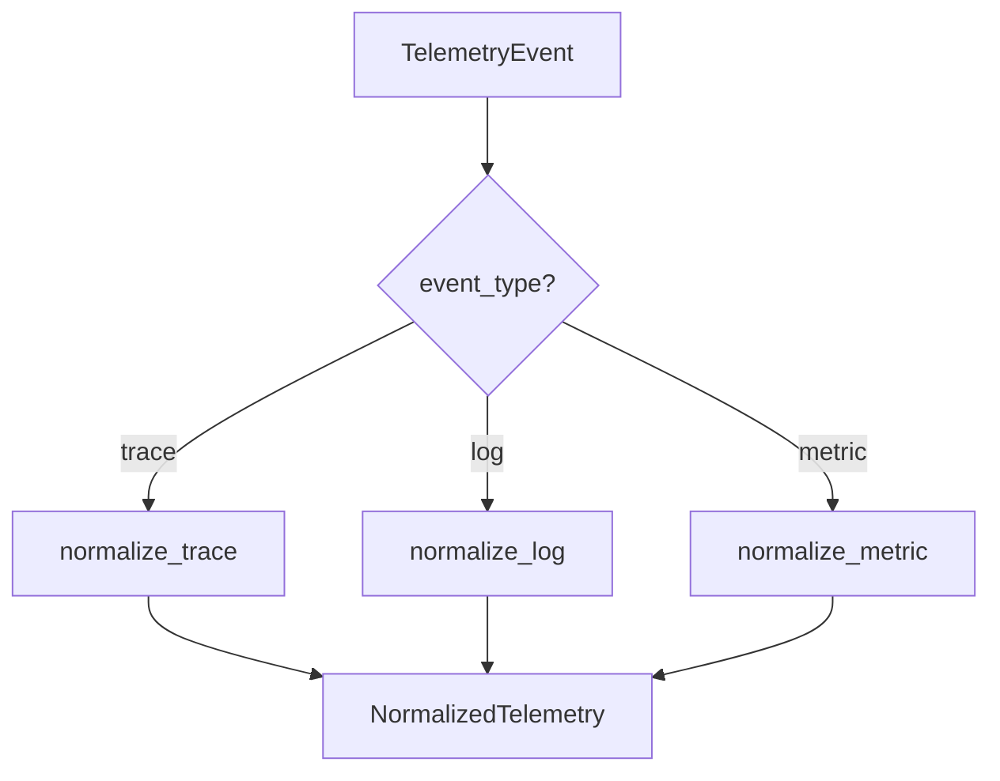

The service is intentionally a thin router — no normalization logic of its own — keeping the architecture modular.

```python
def normalize_event(event: TelemetryEvent) -> NormalizedTelemetry:
    if event.event_type == "trace":
        return normalize_trace(event)
    if event.event_type == "log":
        return normalize_log(event)
    if event.event_type == "metric":
        return normalize_metric(event)
    raise ValueError(f"Unsupported telemetry event type: {event.event_type}")
```

Callers use `normalize_event(event)` rather than knowing about individual normalizers. Unsupported event types raise a clear error.

```bash
pytest -q tests/test_trace_normalizer.py tests/test_log_normalizer.py tests/test_metric_normalizer.py tests/test_normalization_service.py tests/test_normalized_telemetry.py
```

**27 tests passed** — the normalized telemetry schema, all three normalizers, and the unified pipeline work correctly together:

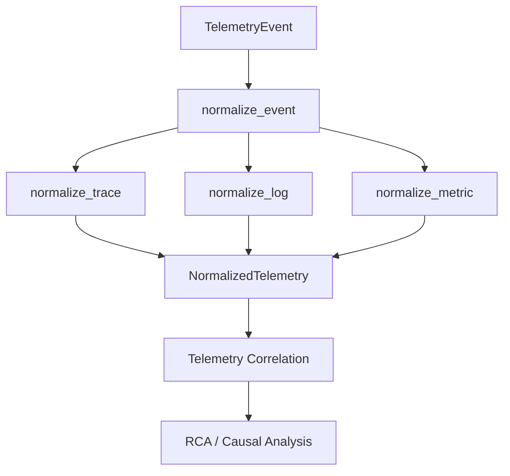

### Normalization Roadmap

| Task | Status |
|---|---|
| Freeze normalization contract | ✅ Complete |
| Define normalized telemetry schema | ✅ Complete |
| Trace normalization | ✅ Complete |
| Log normalization | ✅ Complete |
| Metric normalization | ✅ Complete |
| Normalization service / pipeline | ✅ Complete |
| Pipeline-level normalization tests | ✅ Complete |
| Final verification & documentation closeout | ✅ Complete |

### Final Verification

```text
30 passed
```

The complete normalization test suite passes. Telemetry Normalization is fully complete:

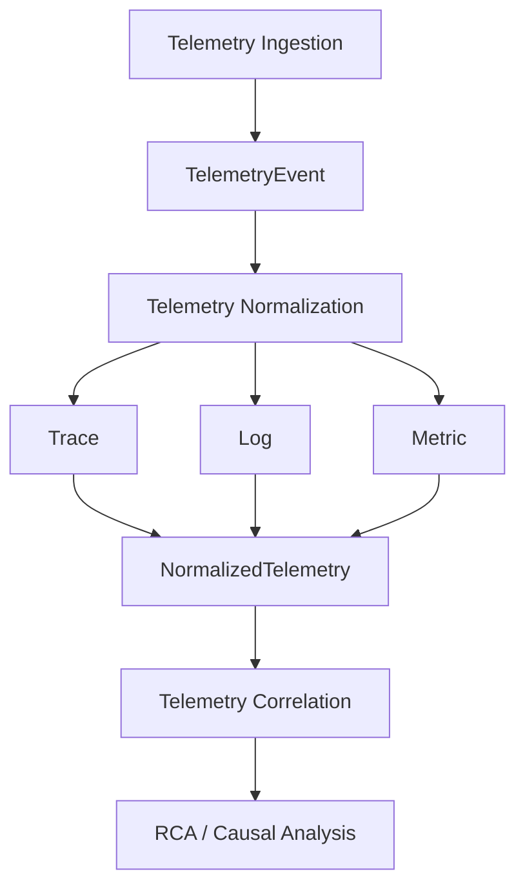

---

## Telemetry Correlation

**Status:** ✅ Complete

### Why Correlation Matters

A single incident can surface as several unrelated-looking telemetry events:

```text
10:00:01  Trace  → payment-service → process-payment → ERROR
10:00:01  Log    → payment-service → "Database timeout"
10:00:02  Metric → payment-service → CPU = 95%
```

These are three separate events, but they likely belong to the same incident. Normalization tells us what each event looks like; correlation tells us which events belong together.

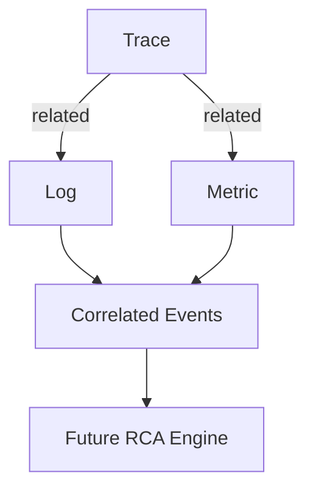

### Correlation Contract & Identifiers

Correlation is built on `NormalizedTelemetry` using four fields as correlation identifiers:

| Identifier | Strength | Purpose |
|---|---|---|
| `trace_id` | 🟢 Strong | Same distributed request |
| `span_id` | 🟢 Strong | Same operation / span |
| `service_name` | 🟡 Medium | Same microservice |
| `timestamp` | 🟡 Medium | Events happened near each other |

`event_id` uniquely identifies an event but never establishes correlation on its own.

### Correlation Rules

Each pair of events is scored against a fixed rule set:

| Match | Strength |
|---|---|
| Same `trace_id` + same `span_id` | `VERY_STRONG` |
| Same `trace_id` | `STRONG` |
| Same `service_name` + within 5 seconds | `MEDIUM` |
| No matching rule | No correlation |

Giving correlations a strength — rather than a boolean — matters because later causal analysis can weight stronger relationships more heavily.

Every match produces a `CorrelationResult`:

```text
Event A ──────── correlation ──────── Event B
                 │
                 ├─ type
                 ├─ strength
                 └─ reason
```

### Trace–Log Correlation

The first and strongest rule: a trace and a log are correlated when they share the same `trace_id`.

```text
Trace:  trace_id = abc123, service = payment-service, operation = process-payment, status = ERROR
Log:    trace_id = abc123, service = payment-service, message = "Database connection timeout"
```

Test coverage includes: matching `trace_id` → `STRONG`; differing `trace_id` → no correlation; missing `trace_id` → no trace-ID correlation.

### Trace–Metric Correlation

A metric doesn't carry a `trace_id`, so trace–metric correlation uses the service + time rule:

```text
trace.service_name == metric.service_name
AND
|trace.timestamp - metric.timestamp| <= 5 seconds
```

```text
Trace:   service = payment-service, time = 10:00:01
Metric:  service = payment-service, time = 10:00:04, CPU = 95%
```

A 3-second gap on the same service → `MEDIUM` correlation. Events on different services, or more than 5 seconds apart, are not correlated by this rule.

### Time / Service-Based Correlation

The service + time rule was generalized into a single reusable function:

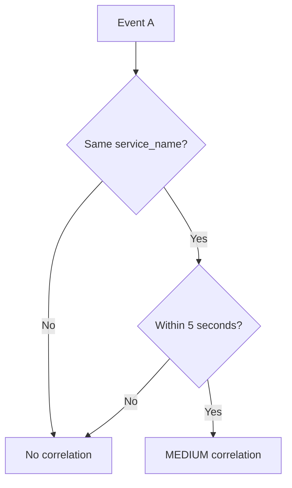

This covers trace↔log, trace↔metric, log↔metric, and metric↔metric pairs.

### Unified Correlation Service / Pipeline

A single entry point applies all rules:

```python
def correlate_events(
    events: list[NormalizedTelemetry],
) -> list[CorrelationResult]:
    ...
```

It takes a list of normalized events and returns every valid correlation, applying rules in order of strength:

| Situation | Rule | Strength |
|---|---|---|
| Trace + Log, same `trace_id` | Trace-ID match | `STRONG` |
| Trace + Metric | Same service + ≤ 5 sec | `MEDIUM` |
| Any compatible events | Same service + ≤ 5 sec | `MEDIUM` |

The service never modifies the telemetry events — it only produces relationships between them.

### Correlation Roadmap

| Task | Status |
|---|---|
| Inspect normalized telemetry and freeze correlation contract | ✅ Complete |
| Define correlation identifiers and matching rules | ✅ Complete |
| Trace–log correlation | ✅ Complete |
| Trace–metric correlation | ✅ Complete |
| Time / service-based correlation | ✅ Complete |
| Unified correlation service / pipeline | ✅ Complete |
| Correlation tests, final verification & documentation closeout | ✅ Complete |

### Final Verification

```text
23 passed
```

Confirmed trace–log correlation via `trace_id` (and `trace_id` + `span_id`), trace–metric correlation via service and time proximity, the generic service/time rule, and the unified correlation service all work correctly together.

---

## Service Topology + Neo4j

**Status:** ✅ Complete

Transforms relationships observed in normalized telemetry into a persistent service dependency graph in Neo4j. The topology layer provides structural context required by later RCA, Graph RAG, blast-radius analysis, and dashboard visualization.

### Why Service Topology Matters

Distributed systems contain multiple services that communicate with each other:

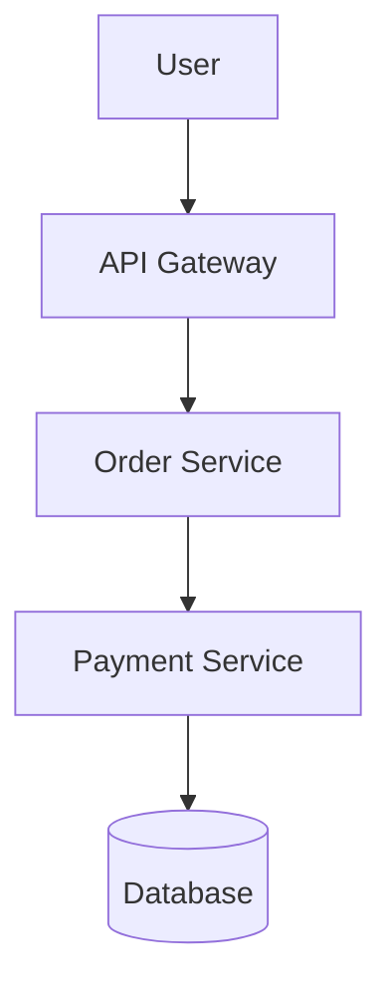

When an incident occurs, knowing that a service is failing is not enough. TraceRCA must also understand which services depend on it, which services it depends on, how failures can propagate, and which services may be affected.

### Topology Architecture

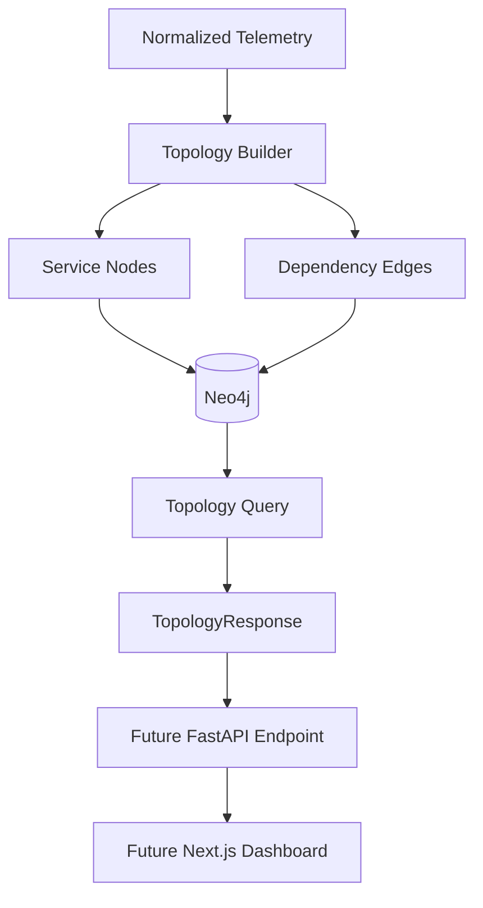

### Topology Contract

**Service Node** — every unique service becomes a node:

```text
Service
├── service_name
├── first_seen
├── last_seen
└── attributes
```

**Dependency Edge** — a relationship between two services:

```text
Source Service
      │
      │ DEPENDS_ON
      ▼
Target Service
```

Dependencies are derived from parent/child service relationships observed within a trace, not from events simply occurring near each other in time.

### Topology Construction Rules

| Situation | Result |
|---|---|
| Same service observed repeatedly | Reuse the same `Service` node |
| Different services connected through a valid trace/span relationship | Create a dependency edge |
| Same dependency observed repeatedly | Reuse/update the existing edge |
| Same service as source and target | Reject self-dependency |
| Services only close in time | Do not create a dependency |
| Insufficient relationship information | Do not invent a dependency |

**Critical rule:** TraceRCA must not infer a service dependency merely because two services generated telemetry near each other in time. Topology dependencies require structural evidence from the trace/span relationship.

### Topology Schemas

**`ServiceNode`** and **`DependencyEdge`** map onto Neo4j nodes and relationships. **`TopologyResponse`** gives downstream consumers a single representation of the complete service graph.

### Neo4j Infrastructure

Neo4j runs in a Docker container named `tracerca-neo4j`:

| Interface | Address |
|---|---|
| Browser | `localhost:7474` |
| Bolt | `localhost:7687` |

The data directory uses a persistent Docker volume. Configuration lives in `backend/app/core/config.py` via environment variables; the local `.env` file is Git-ignored.

### Neo4j Connection Layer

An asynchronous Neo4j connection layer at `backend/app/db/neo4j.py` uses the official Neo4j Python driver for async driver creation, connectivity verification, and connection cleanup.

### Service-Node Creation / Upsert

Implemented in `backend/app/telemetry/topology_service.py` using Neo4j `MERGE` for idempotent service creation. Repeated observations never create duplicate service nodes — `first_seen` is preserved and `last_seen` is updated.

### Dependency-Edge Creation / Upsert

Relationships use `(:Service)-[:DEPENDS_ON]->(:Service)` with `MERGE`. Both service nodes must exist before a dependency is created. Repeated observations update the existing relationship.

```bash
pytest -q tests/test_topology_service.py
```

**1 passed** — confirms Neo4j creates `test-api-service → DEPENDS_ON → test-database-service` against a real database.

### Topology Construction Pipeline

`backend/app/telemetry/topology_builder.py` accepts `NormalizedTelemetry` and builds the graph from it. Trace parent/child relationships become service dependencies. The builder does **not** create a dependency when service names are missing, events are not traces, or both spans belong to the same service.

### Topology Query / Retrieval

`get_topology()` retrieves services and dependencies from Neo4j as a `TopologyResponse`:

```json
{
  "services": [
    { "service_name": "payment-service", "first_seen": "...", "last_seen": "..." }
  ],
  "dependencies": [
    { "source_service": "payment-service", "target_service": "order-service", "first_seen": "...", "last_seen": "..." }
  ]
}
```

This creates a clean boundary between the Neo4j graph and future API/dashboard consumers.

### Dashboard Integration Direction

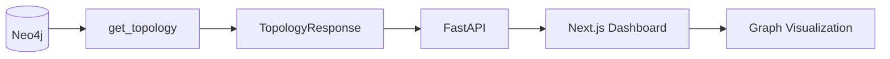

The dashboard will visualize chains like `Frontend → API → Order Service → Payment Service → Database` without the frontend needing to understand Neo4j or Cypher.

### Topology Testing & Verification

Dedicated tests in `tests/test_topology.py` and `tests/test_topology_service.py` cover service-node creation, dependency-edge validation, Neo4j upserts, topology construction, retrieval, and integration.

```bash
pytest -q tests/test_topology.py tests/test_topology_service.py
```

**11 tests passed.**

Full regression run:

```bash
pytest -q
```

**92 passed, 6 warnings** — new Neo4j/topology functionality did not break existing telemetry ingestion, normalization, correlation, or other project functionality.

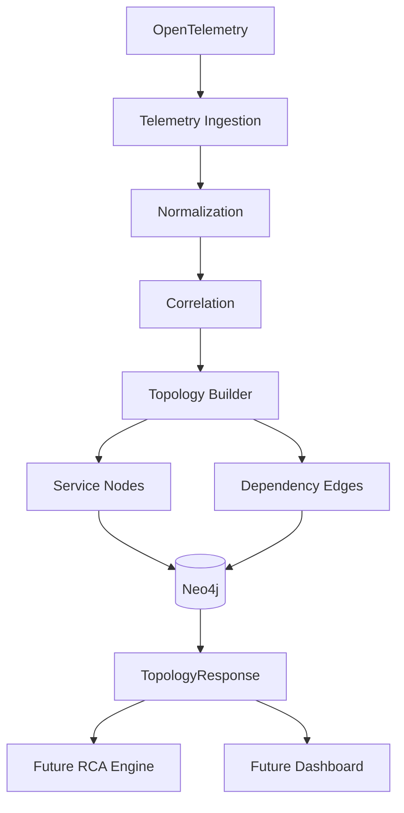

Service topology completes the structural foundation required by the later RCA and Graph RAG layers.

---

## Basic Anomaly Detection

**Status:** ✅ Complete

Completes the final layer of the Part 1 Observability Foundation by detecting abnormal behavior across latency, error rates, and telemetry metrics.

### Anomaly Detection Objective

The anomaly detection layer compares observed telemetry behavior against an expected baseline:

```text
Observed Telemetry
       ↓
Expected Baseline
       ↓
Deviation Calculation
       ↓
Threshold Evaluation
       ↓
Anomaly
```

An anomaly is a telemetry observation whose behavior significantly deviates from the expected behavior of a service. The initial implementation uses simple, explainable threshold-based detection rather than ML-based anomaly detection — this keeps the system explainable, which matters when anomaly detection feeds into RCA:

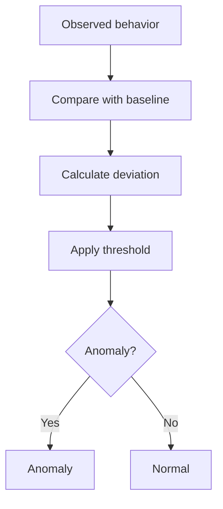

Three anomaly types are detected:

| Anomaly | Example |
|---|---|
| Latency anomaly | A service normally responds in 100 ms but suddenly takes 900 ms |
| Error-rate anomaly | A service normally has 1% errors but suddenly reaches 30% |
| Metric anomaly | CPU normally stays around 40% but suddenly reaches 95% |

### Anomaly Contract

Every detected anomaly contains:

| Field | Purpose |
|---|---|
| `anomaly_id` | Unique anomaly identifier |
| `service_name` | Service where the anomaly occurred |
| `anomaly_type` | `LATENCY`, `ERROR_RATE`, or `METRIC` |
| `timestamp` | Time of the detected anomaly |
| `observed_value` | Actual observed value |
| `expected_value` | Expected baseline value |
| `severity` | `LOW`, `MEDIUM`, or `HIGH` |
| `description` | Human-readable explanation |

### Latency Anomaly Detection

Compares observed trace duration against an expected latency baseline:

```text
deviation = |observed - expected| / expected
```

| Deviation | Severity |
|---|---|
| < 50% | Normal |
| 50% – <100% | LOW |
| 100% – <200% | MEDIUM |
| ≥ 200% | HIGH |

Invalid values (zero expected latency, negative observed latency) are rejected.

### Error-Rate Anomaly Detection

Compares observed error rate against expected error-rate baseline using percentage-point deviation:

```text
deviation = |observed_error_rate - expected_error_rate|
```

| Deviation | Severity |
|---|---|
| < 5 pp | Normal |
| 5 – <10 pp | LOW |
| 10 – <20 pp | MEDIUM |
| ≥ 20 pp | HIGH |

Observed and expected error rates must be between 0 and 100.

### Metric Anomaly Detection

Uses relative deviation from an expected baseline for numeric metrics:

```text
deviation = |observed - expected| / |expected|
```

| Deviation | Severity |
|---|---|
| < 50% | Normal |
| 50% – <100% | LOW |
| 100% – <200% | MEDIUM |
| ≥ 200% | HIGH |

A zero expected metric value is rejected.

### Unified Anomaly Detection Service

Three detectors exposed through a single service:

```mermaid
flowchart TD
    NT[Normalized Telemetry] --> SVC[AnomalyDetectionService]
    SVC --> LD[Latency Detector]
    SVC --> ED[Error-Rate Detector]
    SVC --> MD[Metric Detector]
    LD --> A[Anomaly]
    ED --> A
    MD --> A
```

Implemented in `backend/app/telemetry/anomaly.py`, `anomaly_detector.py`, and `anomaly_service.py`.

### Anomaly Detection Testing & Verification

```bash
pytest -q tests/test_anomaly_detection.py
```

**19 tests passed** — covering normal behavior and low/medium/high anomalies for all three types, invalid values, and the unified service.

Full regression:

```bash
pytest -q
```

**111 passed, 6 warnings** — warnings are dependency/deprecation warnings, not test failures.

### Part 1 Final Output

With anomaly detection complete, the Part 1 observability pipeline is:

```mermaid
flowchart TD
    OT[OpenTelemetry] --> ING[Telemetry Ingestion]
    ING --> NORM[Telemetry Normalization]
    NORM --> CORR[Telemetry Correlation]
    CORR --> TOPO[Service Topology]
    TOPO --> N4J[(Neo4j)]
    N4J --> ANOM[Anomaly Detection]
    ANOM --> EV[Anomaly Evidence]
```

Part 1 now provides the structured observability foundation required by the AI Root Cause Intelligence layer in Part 2.

---

## Dashboard

**Status:** 🔄 In progress

With Part 1's observability foundation complete, a dashboard is being added so the ingested, normalized, correlated, topology, and anomaly data can be seen and explored. The dashboard reuses Part 1's existing services rather than duplicating logic or introducing fake data.

### Dashboard Data Flow & Architecture

```mermaid
flowchart TD
    T[Test Microservices] --> OT[OpenTelemetry]
    OT --> P1["TraceRCA Part 1 (Ingestion → Normalization → Correlation → Topology → Anomaly Detection)"]
    P1 --> PG[(PostgreSQL / Redis)]
    P1 --> N4J[(Neo4j)]
    PG --> API[FastAPI Dashboard APIs]
    N4J --> API
    API --> UI[Next.js Dashboard]
```

The Next.js frontend never talks directly to PostgreSQL, Redis, or Neo4j — everything goes through FastAPI.

### Architecture Layers

| Layer | Responsibility |
|---|---|
| **Presentation** — Next.js | Dashboard, Traces, Logs, Metrics, Topology, Anomalies, Service pages |
| **API** — FastAPI | Dashboard endpoints, request validation, response schemas |
| **TraceRCA Services** | Telemetry, normalization, correlation, topology, anomaly detection (all from Part 1) |
| **Data** | PostgreSQL, Redis, Neo4j |

### Design Principles

- The frontend never accesses PostgreSQL, Redis, or Neo4j directly — only through FastAPI.
- The dashboard does not duplicate or change Part 1 logic; it adds a thin **Dashboard Router** and **Dashboard Service** on top.
- No endpoint returns hard-coded or fake data — each maps to a real, existing Part 1 source.
- A query/repository layer for dashboard-style reads didn't previously exist, so a small read-only dashboard service layer was introduced rather than placing SQL queries directly in API routes.

### Storage Responsibilities

| Storage | Dashboard Responsibility |
|---|---|
| PostgreSQL | Persistent telemetry/event information |
| Redis | Fast/temporary data and caching where already used |
| Neo4j | Service topology and dependency relationships |

The dashboard does not introduce another database.

### Dashboard Sections → Data Source

| Dashboard Section | Source |
|---|---|
| Overview statistics | TraceRCA backend/storage (aggregated) |
| Traces | Normalized trace telemetry |
| Logs | Normalized log telemetry |
| Metrics | Normalized metric telemetry |
| Topology | Topology service → Neo4j |
| Anomalies | Anomaly detection output |
| Service details | Combination of existing telemetry, topology, and anomaly data |
| Trace details | Trace/span data |
| Root Cause | Part 2 — placeholder |
| Auto-Healing | Part 3 — placeholder |

### Dashboard API Contracts

| Endpoint | Purpose | Real Source |
|---|---|---|
| `GET /dashboard/overview` | Overall system summary | PostgreSQL + topology + anomaly results |
| `GET /dashboard/services` | List monitored services | PostgreSQL / topology |
| `GET /dashboard/topology` | Service dependency graph | Neo4j / `TopologyService` |
| `GET /dashboard/anomalies` | Anomaly list with pagination | PostgreSQL / `AnomalyEvent` |
| `GET /dashboard/anomalies/{id}/correlations` | Correlated evidence for anomaly | PostgreSQL / `AnomalyCorrelation` + `TelemetryEvent` |

---

## Part 1 Final Verification

```bash
pytest -q
```

**111+ tests passed** across all Part 1 workstreams. The complete observability foundation is verified end-to-end.

---

## Project Structure

```
TraceRCA-AI/
├── backend/
│   ├── app/
│   │   ├── api/routes/          # FastAPI routers (telemetry, dashboard, health)
│   │   ├── core/config.py       # Pydantic Settings
│   │   ├── db/                  # SQLAlchemy models, Neo4j connection
│   │   ├── telemetry/           # Ingestion, normalization, correlation, topology, anomaly
│   │   ├── cache/               # Redis client
│   │   └── main.py              # FastAPI app + lifespan
│   ├── alembic/                 # Database migrations
│   ├── requirements.txt
│   └── tests/                   # Unit + integration tests
├── frontend/
│   ├── src/app/                 # Next.js App Router pages
│   ├── package.json
│   └── tsconfig.json
└── README.md
```

---

## Getting Started

### Prerequisites

- Python 3.11+
- Node.js 18+
- PostgreSQL 15+
- Neo4j 5+
- Redis 7+

### Backend Setup

```bash
cd backend
python -m venv .venv
source .venv/bin/activate  # or .venv\Scripts\activate on Windows
pip install -r requirements.txt
cp .env.example .env  # Configure database, Neo4j, Redis URLs
alembic upgrade head
uvicorn app.main:app --reload
```

### Frontend Setup

```bash
cd frontend
npm install
npm run dev
```

Visit `http://localhost:3000` for the dashboard; API runs at `http://localhost:8000`.

---

## Testing

```bash
# Backend tests
cd backend
pytest -q

# Frontend lint/typecheck
cd frontend
npm run lint
npx tsc --noEmit
```