# TraceRCA AI

**Distributed OpenTelemetry Multi-Layer Causal Inference & Auto-Healing Engine**

TraceRCA AI is an observability and root-cause-analysis (RCA) platform for distributed, microservice-based systems. It connects traces, logs, metrics, and topology into a single evidence chain, so that the *actual* cause of a failure can be found, explained, and safely remediated.

---

## Table of Contents

- [Overview](#overview)
- [Key Capabilities](#key-capabilities)
- [Project Vision](#project-vision)
- [Architecture](#architecture)
- [Project Status](#project-status)
- [Telemetry Ingestion API](#telemetry-ingestion-api)
- [OpenTelemetry Integration](#opentelemetry-integration)
- [Database Schema Evolution](#database-schema-evolution)
- [Telemetry Normalization](#telemetry-normalization)
  - [Why Normalization Matters](#why-normalization-matters)
  - [Normalized Telemetry Schema](#normalized-telemetry-schema)
  - [Trace Normalization](#trace-normalization)
  - [Log Normalization](#log-normalization)
  - [Metric Normalization](#metric-normalization)
  - [Normalization Service / Pipeline](#normalization-service--pipeline)
  - [Normalization Roadmap](#normalization-roadmap)
- [Telemetry Correlation](#telemetry-correlation)
  - [Why Correlation Matters](#why-correlation-matters)
  - [Correlation Contract & Identifiers](#correlation-contract--identifiers)
  - [Correlation Rules](#correlation-rules)
  - [Trace–Log Correlation](#tracelog-correlation)
  - [Trace–Metric Correlation](#tracemetric-correlation)
  - [Time / Service-Based Correlation](#time--service-based-correlation)
  - [Unified Correlation Service / Pipeline](#unified-correlation-service--pipeline)
  - [Correlation Roadmap](#correlation-roadmap)
- [Service Topology + Neo4j](#service-topology--neo4j)
  - [Why Service Topology Matters](#why-service-topology-matters)
  - [Topology Architecture](#topology-architecture)
  - [Topology Contract](#topology-contract)
  - [Topology Construction Rules](#topology-construction-rules)
  - [Topology Schemas](#topology-schemas)
  - [Neo4j Infrastructure](#neo4j-infrastructure)
  - [Neo4j Connection Layer](#neo4j-connection-layer)
  - [Service-Node Creation / Upsert](#service-node-creation--upsert)
  - [Dependency-Edge Creation / Upsert](#dependency-edge-creation--upsert)
  - [Topology Construction Pipeline](#topology-construction-pipeline)
  - [Topology Query / Retrieval](#topology-query--retrieval)
  - [Dashboard Integration Direction](#dashboard-integration-direction)
  - [Topology Testing & Verification](#topology-testing--verification)
  - [Topology Roadmap](#topology-roadmap)
- [Basic Anomaly Detection](#basic-anomaly-detection)
  - [Anomaly Detection Objective](#anomaly-detection-objective)
  - [Anomaly Contract](#anomaly-contract)
  - [Latency Anomaly Detection](#latency-anomaly-detection)
  - [Error-Rate Anomaly Detection](#error-rate-anomaly-detection)
  - [Metric Anomaly Detection](#metric-anomaly-detection)
  - [Unified Anomaly Detection Service](#unified-anomaly-detection-service)
  - [Anomaly Detection Testing & Verification](#anomaly-detection-testing--verification)
  - [Part 1 Final Output](#part-1-final-output)
  - [Anomaly Detection Roadmap](#anomaly-detection-roadmap)
- [Dashboard](#dashboard)
  - [Dashboard Data Flow & Architecture](#dashboard-data-flow--architecture)
  - [Architecture Layers](#architecture-layers)
  - [Design Principles](#design-principles)
  - [Storage Responsibilities](#storage-responsibilities)
  - [Dashboard Sections → Data Source](#dashboard-sections--data-source)
  - [Dashboard API Contracts](#dashboard-api-contracts)
  - [Frontend Structure](#frontend-structure)
  - [Demo Microservice](#demo-microservice)
  - [Dashboard Roadmap](#dashboard-roadmap)
- [Part 1 Final Verification](#part-1-final-verification)
- [Project Structure](#project-structure)
- [Getting Started](#getting-started)
- [Testing](#testing)

---

## Overview

Modern systems can contain dozens or hundreds of interconnected services. When something fails, the visible error is rarely the real cause. TraceRCA AI is built to answer the full chain of incident questions:

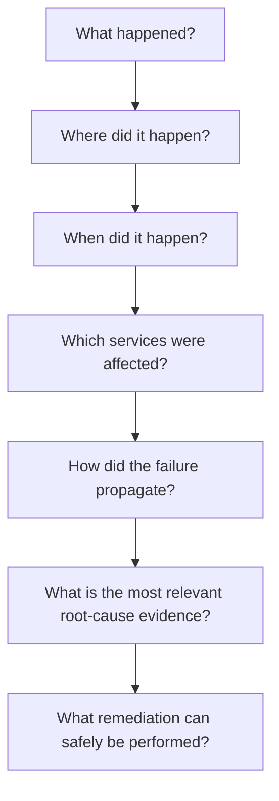

## Key Capabilities

| Area | Capability |
|---|---|
| **Telemetry** | OpenTelemetry traces, application logs, infrastructure metrics |
| **Context** | Service metadata, service dependency graphs, deployment and configuration changes |
| **Correlation** | Incident and alert correlation, temporal dependency analysis |
| **Intelligence** | Causal inference, Graph RAG, evidence-based root-cause analysis |
| **Impact** | Blast-radius analysis |
| **Action** | Remediation recommendations, controlled auto-healing |

---

## Project Vision

A single user request can travel through many components:

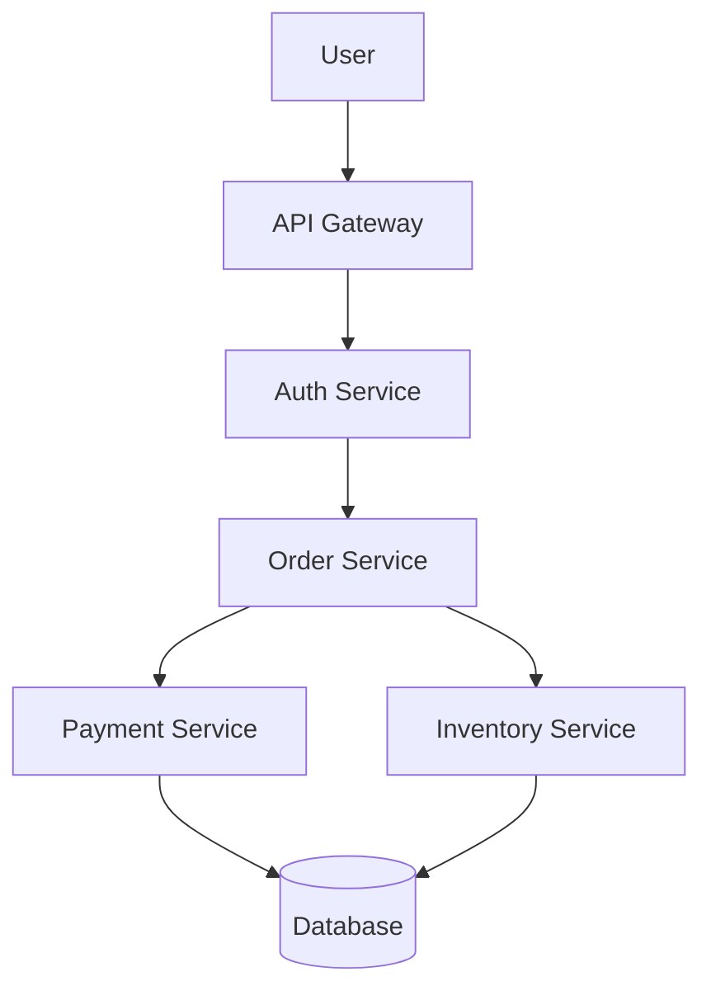

When a failure occurs, the visible symptom may sit far from the underlying cause. For example:

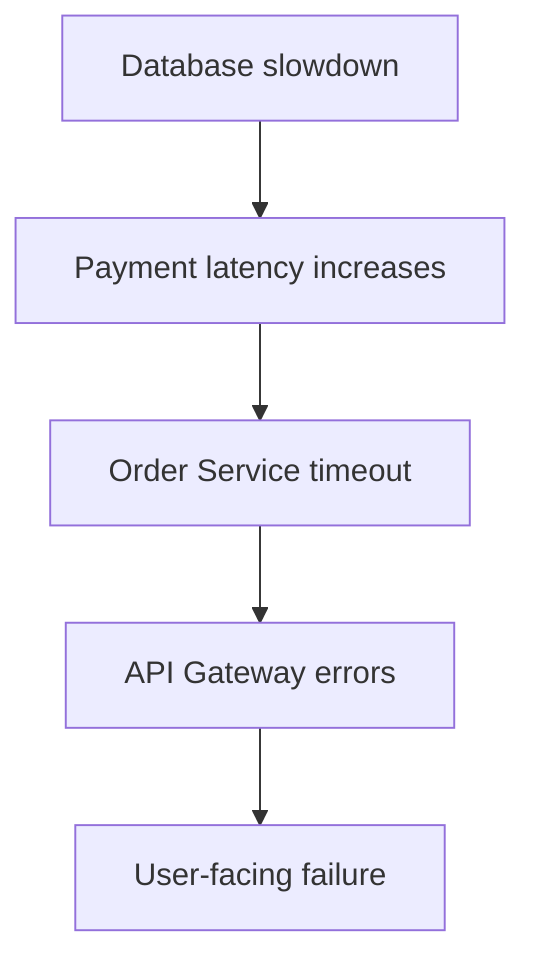

Traditional monitoring shows each of these signals separately. TraceRCA AI connects them and preserves the relationships required for deeper analysis.

### Core Problem

Distributed systems produce many kinds of operational data:

- Distributed traces
- Application logs
- Infrastructure metrics
- Service metadata and dependency relationships
- Alerts and incident information
- Deployment and configuration changes

The challenge is not collecting this data. It is **understanding** it: correlating signals across services and time to find the root cause and decide what can be fixed safely.

---

## Architecture

The project is delivered in three parts:

| Part | Name | Focus |
|---|---|---|
| **Part 1** | Observability Foundation | Ingest, normalize, and correlate telemetry; build service topology; detect anomalies |
| **Part 2** | AI Root Cause Intelligence | Causal inference, Graph RAG, evidence-based RCA, blast-radius analysis |
| **Part 3** | Auto-Healing & Production | Remediation recommendations, controlled auto-healing, production hardening |

### Part 1 — Observability Foundation

Part 1 produces reliable, structured information for the AI intelligence layer to consume.

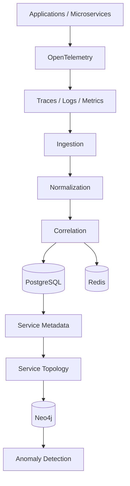

**Expected output of Part 1:** Telemetry → Normalized Events → Correlated Events → Service Topology → Anomalies.

---

## Project Status

**Part 1 (Observability Foundation) is complete.**

| Part | Status |
|---|---|
| Part 1 — Observability Foundation | ✅ Complete — ingestion, normalization, correlation, service topology, and anomaly detection complete |
| Part 2 — AI Root Cause Intelligence | ⏳ Planned |
| Part 3 — Auto-Healing & Production | ⏳ Planned |

### Part 1 Workstreams

| Workstream | Status |
|---|---|
| Telemetry Ingestion API | ✅ Complete |
| OpenTelemetry Integration | ✅ Complete |
| Database Schema Evolution (trace fields) | ✅ Complete |
| Telemetry Normalization | ✅ Complete |
| Telemetry Correlation | ✅ Complete |
| Service Topology + Neo4j | ✅ Complete |
| Basic Anomaly Detection | ✅ Complete |
| Dashboard | 🔄 In progress — architecture, API contracts, and topology view verified |

---

## Telemetry Ingestion API

The Telemetry Ingestion API is the entry point for telemetry from OpenTelemetry-enabled services. It validates incoming data, converts it into the internal `TelemetryEvent` model, and persists it to PostgreSQL.

**Status:** ✅ Complete

### Endpoints

| Method | Endpoint | Purpose |
|---|---|---|
| `POST` | `/telemetry/traces` | Ingest trace spans |
| `POST` | `/telemetry/logs` | Ingest application logs |
| `POST` | `/telemetry/metrics` | Ingest infrastructure metrics |

### Request Flow

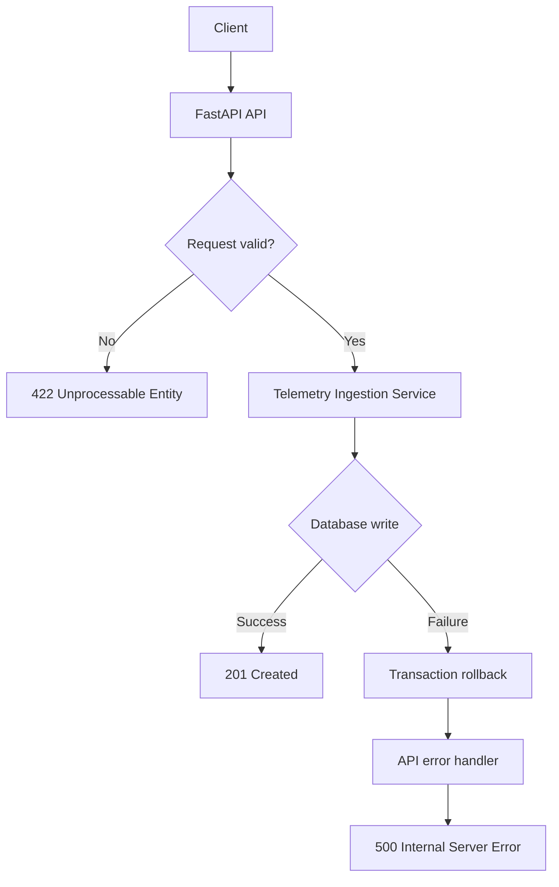

### Build Checklist

- [x] Freeze telemetry contracts
- [x] Create Pydantic telemetry ingestion schemas
- [x] Implement telemetry ingestion service
- [x] Implement `POST /telemetry/traces`
- [x] Implement `POST /telemetry/logs`
- [x] Implement `POST /telemetry/metrics`
- [x] Connect ingestion service to PostgreSQL
- [x] Error handling and validation
- [x] Unit and API tests
- [x] OpenTelemetry integration test

### Validation Rules

Validation is enforced with Pydantic. Whitespace-only values are rejected for important string fields, maximum lengths are enforced on identifiers and messages, and flexible OpenTelemetry attributes are preserved.

| Signal | Rules |
|---|---|
| **Traces** | `trace_id`, `span_id`, `service_name`, `operation_name` must be non-empty; optional parent span ID has a maximum length; `duration_ms` must not be negative; `status` must be `UNSET`, `OK`, or `ERROR` |
| **Logs** | `service_name` and `message` must be non-empty; maximum message length; timestamp must be valid |
| **Metrics** | `service_name` and `metric_name` must be non-empty and valid; `metric_value` must be numeric; timestamp must be valid |

Invalid requests return `422 Unprocessable Entity`.

### Error Handling

The ingestion service handles SQLAlchemy errors and operating-system/database connection errors. On failure it:

1. Rolls back the active transaction, so no partial writes are left behind.
2. Re-raises the original exception.
3. Lets the API layer translate it into a consistent client response, without exposing internal database details.

All three endpoints return the same structure on persistence failure:

```http
HTTP/1.1 500 Internal Server Error
```

```json
{
  "detail": "Failed to persist telemetry event"
}
```

| Scenario | Status Code |
|---|---|
| Event stored successfully | `201 Created` |
| Invalid request payload | `422 Unprocessable Entity` |
| Database / persistence failure | `500 Internal Server Error` |

### Testing & Verification

Coverage includes trace, log, and metric persistence; successful and invalid API requests for all three telemetry types; and database failure / transaction rollback handling. API success-path tests isolate the HTTP contract from real persistence, while the ingestion service tests verify actual PostgreSQL writes.

```bash
pytest -q tests/test_ingestion_service.py tests/test_telemetry_api.py
```

**16 tests passed** — schema validation works for traces, logs, and metrics; database errors are handled and rolled back at the service layer; all endpoints return a consistent `500` on persistence failure; existing ingestion functionality is unaffected.

---

## OpenTelemetry Integration

**Status:** ✅ Complete

This verifies the complete telemetry flow from an OpenTelemetry span through to PostgreSQL, using the real ingestion service and a real database rather than mocking persistence.

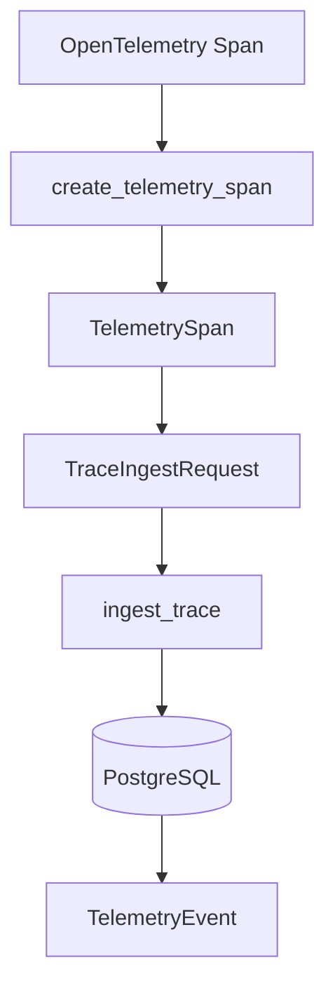

This confirms that the OpenTelemetry foundation feeds correctly into the telemetry ingestion pipeline.

### Verification

| Test run | Result |
|---|---|
| Full project test suite | 28 passed |
| OpenTelemetry integration test (standalone) | 1 passed |
| Existing OpenTelemetry tests + integration test | 3 passed |

### Output

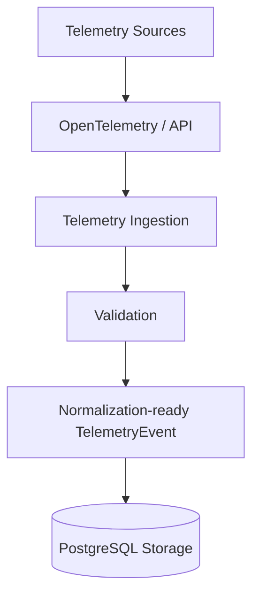

This output is the input boundary for telemetry normalization:

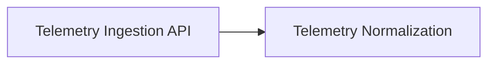

---

## Database Schema Evolution

**Status:** ✅ Complete

Inspected the telemetry data produced by ingestion and compared the ingestion schemas, SQLAlchemy models, and the actual PostgreSQL table structure.

### Findings

The `telemetry_events` table already stored:

`event_type`, `timestamp`, `service_name`, `trace_id`, `span_id`, `parent_span_id`, `message`, `metric_name`, `metric_value`, `attributes`, `created_at`

However, the trace ingestion schema already accepted three fields that were **not** being persisted:

- `operation_name`
- `duration_ms`
- `status`

These matter for the RCA pipeline because:

| Field | Why it matters |
|---|---|
| `operation_name` | Identifies the failing or slow operation |
| `duration_ms` | Enables latency and performance analysis |
| `status` | Enables error/failure detection |

### Schema Update

The `TelemetryEvent` SQLAlchemy model was updated with:

```text
operation_name  VARCHAR(255)
duration_ms     FLOAT
status          VARCHAR(50)
```

### Migration

An Alembic migration was generated and applied:

```text
ce12331ef2cd → c0ebede2393f_add_trace_fields_to_telemetry_events.py
```

PostgreSQL verification confirmed the three new columns are present on `telemetry_events`. Existing log and metric records correctly show the new fields as `None` for historical rows created before the schema update.

### Trace Ingestion Update

The trace ingestion service was updated to persist `operation_name`, `duration_ms`, and `status` on new trace events.

```bash
pytest -q tests/test_ingestion_service.py tests/test_telemetry_integration.py
```

**7 tests passed** — the updated trace ingestion service correctly persists `operation_name`, `duration_ms`, and `status`; existing log and metric ingestion is unaffected; an OpenTelemetry trace flows end to end through the ingestion pipeline into PostgreSQL.

---

## Telemetry Normalization

**Status:** ✅ Complete

### Why Normalization Matters

Telemetry arrives in three different shapes:

```text
Trace:  service_name, operation_name, duration_ms, status, trace_id
Log:    service_name, message, trace_id
Metric: service_name, metric_name, metric_value
```

If these are sent directly to the RCA engine, it has to understand three different formats. Normalization converts all three into one common structure before anything downstream sees them:

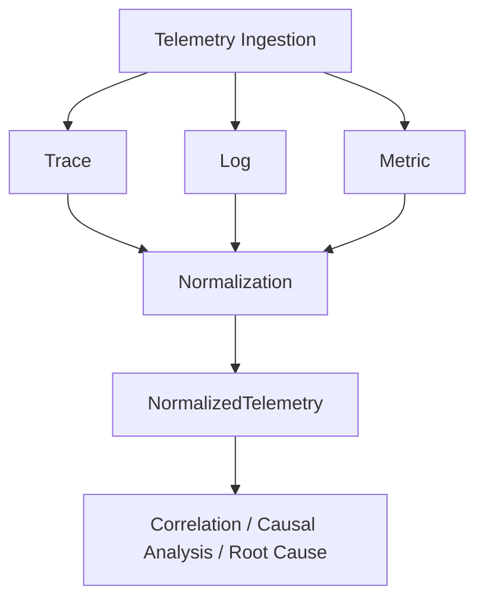

This is what lets the RCA engine ask cross-signal questions such as *"did the CPU spike happen before the request became slow?"* or *"did the database error occur during the failed trace?"* — questions that require traces, logs, and metrics to already speak the same language.

> **Normalization** = converting different telemetry formats into one common language so the rest of TraceRCA can analyze traces, logs, and metrics together.

Raw ingestion schemas are not replaced — they are kept as the input boundary, and normalization sits as a layer after them:

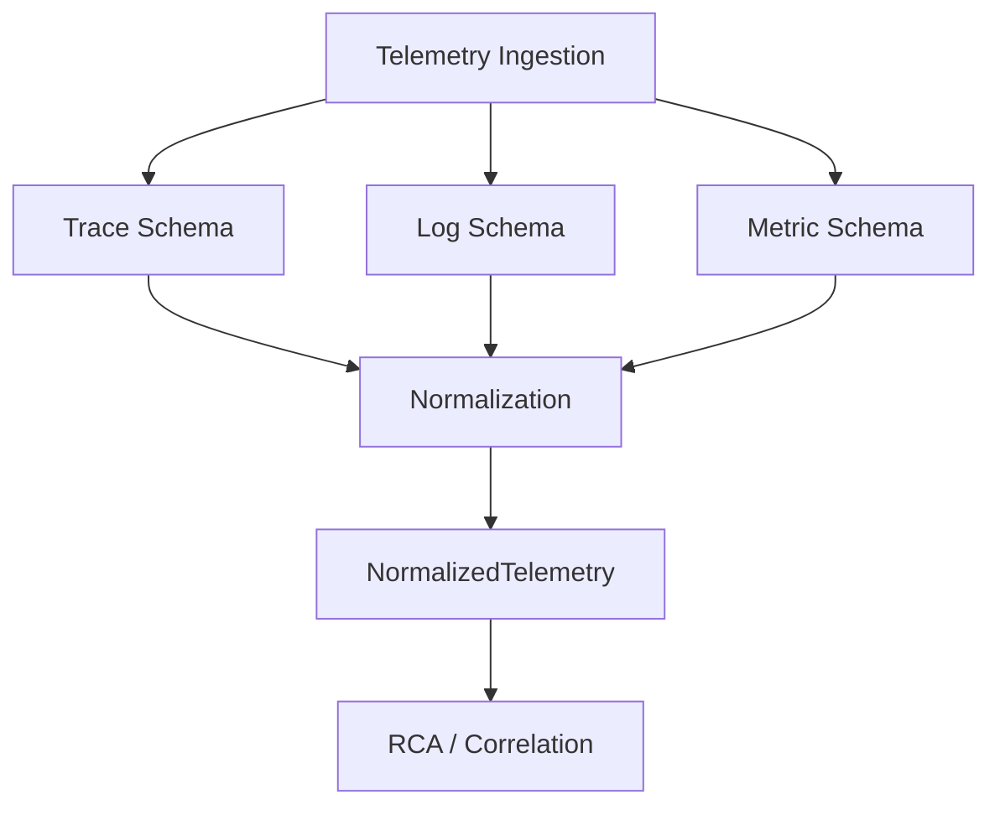

### Normalized Telemetry Schema

Rather than three separate normalized schemas (one each for traces, logs, metrics), a single common schema was designed:

```text
                 NormalizedTelemetry
                /         |          \
            Trace        Log        Metric
```

| Field | Type | Required | Used by |
|---|---|---|---|
| `event_id` | UUID | ✅ | all |
| `event_type` | `trace` / `log` / `metric` | ✅ | all |
| `timestamp` | datetime | ✅ | all |
| `service_name` | string | ✅ | all |
| `operation_name` | string \| None | — | trace |
| `trace_id` | string \| None | — | trace, log |
| `span_id` | string \| None | — | trace, log |
| `parent_span_id` | string \| None | — | trace |
| `duration_ms` | float \| None | — | trace |
| `status` | `UNSET`/`OK`/`ERROR` \| None | — | trace |
| `message` | string \| None | — | log |
| `metric_name` | string \| None | — | metric |
| `metric_value` | float \| None | — | metric |
| `attributes` | `dict[str, Any]` | ✅ | all |

**Validation rules:**

- `event_type` must be `trace`, `log`, or `metric`
- `service_name` is required and cannot be empty or whitespace-only
- `duration_ms` cannot be negative
- `status` must be `UNSET`, `OK`, or `ERROR`
- `message` cannot be empty if provided
- `metric_name` has string length limits
- Identifier fields are optional strings with length limits
- `attributes` must be a dictionary

```bash
pytest -q
```

**9 tests passed**, confirming:

- Valid `NormalizedTelemetry` objects are accepted
- Invalid `event_type` is rejected
- Negative `duration_ms` is rejected
- Empty `service_name` is rejected
- Invalid `status` is rejected
- Empty `message` is rejected
- Trace, log, and metric telemetry all fit the common schema

### Trace Normalization

**Status:** ✅ Complete

| Source field (`TelemetryEvent`) | Normalized field |
|---|---|
| `id` | `event_id` |
| `event_type` | `event_type` |
| `timestamp` | `timestamp` |
| `service_name` | `service_name` |
| `operation_name` | `operation_name` |
| `trace_id` | `trace_id` |
| `span_id` | `span_id` |
| `parent_span_id` | `parent_span_id` |
| `duration_ms` | `duration_ms` |
| `status` | `status` |
| `attributes` | `attributes` |

`message`, `metric_name`, and `metric_value` remain `None` for trace events.

```python
NormalizedTelemetry(
    event_type="trace",
    service_name="payment-service",
    operation_name="process-payment",
    duration_ms=245.5,
    status="ERROR",
    trace_id="abc123",
    span_id="span456",
)
```

A guard prevents other event types from reaching the trace normalizer:

```python
if event.event_type != "trace":
    raise ValueError("Expected a trace telemetry event")
```

```bash
pytest -q tests/test_trace_normalizer.py tests/test_normalized_telemetry.py
```

**13 tests passed** — trace telemetry is correctly transformed from the persisted `TelemetryEvent` into `NormalizedTelemetry`; all trace fields are preserved; non-trace events are rejected by the trace normalizer; missing optional fields and attributes are handled safely.

### Log Normalization

**Status:** ✅ Complete

| Source field (`TelemetryEvent`) | Normalized field |
|---|---|
| `id` | `event_id` |
| `event_type` | `event_type` |
| `timestamp` | `timestamp` |
| `service_name` | `service_name` |
| `trace_id` | `trace_id` |
| `span_id` | `span_id` |
| `message` | `message` |
| `attributes` | `attributes` |

`operation_name`, `parent_span_id`, `duration_ms`, `status`, `metric_name`, and `metric_value` remain `None` for log events.

```python
NormalizedTelemetry(
    event_type="log",
    service_name="payment-service",
    message="Database connection failed",
    trace_id="abc123",
    span_id="span456",
    attributes={"level": "ERROR"},
)
```

Edge cases tested: a log without `trace_id`, a log without `span_id`, and a log with `attributes=None` (which normalizes to `{}`).

```bash
pytest -q tests/test_log_normalizer.py
```

**2 tests passed** — log telemetry normalizes correctly, with optional fields and missing attributes handled safely.

### Metric Normalization

**Status:** ✅ Complete

Converts persisted `TelemetryEvent` metric records into the common `NormalizedTelemetry` representation.

| Source field (`TelemetryEvent`) | Normalized field |
|---|---|
| `id` | `event_id` |
| `event_type` | `event_type` |
| `timestamp` | `timestamp` |
| `service_name` | `service_name` |
| `metric_name` | `metric_name` |
| `metric_value` | `metric_value` |
| `attributes` | `attributes` |

`operation_name`, `trace_id`, `span_id`, `parent_span_id`, `duration_ms`, `status`, and `message` remain `None` for metric events.

```python
NormalizedTelemetry(
    event_type="metric",
    service_name="payment-service",
    metric_name="cpu_usage",
    metric_value=95.4,
    attributes={...},
)
```

A guard prevents other event types from reaching the metric normalizer, and attributes are handled safely when missing:

```python
if event.event_type != "metric":
    raise ValueError("Expected a metric telemetry event")
```

Zero and negative metric values are preserved correctly rather than being treated as missing data.

```bash
pytest -q tests/test_metric_normalizer.py
```

**5 tests passed.**

Combined verification across all three normalizers:

```bash
pytest -q tests/test_trace_normalizer.py tests/test_log_normalizer.py tests/test_metric_normalizer.py
```

**14 tests passed** — trace, log, and metric telemetry can all be transformed correctly into the common `NormalizedTelemetry` structure, and the metric normalizer handles optional attributes and valid metric values safely.

### Normalization Service / Pipeline

**Status:** ✅ Complete

With all three event-specific normalizers in place, a single routing layer was added so the rest of the system doesn't need to know which normalizer to call for a given event:

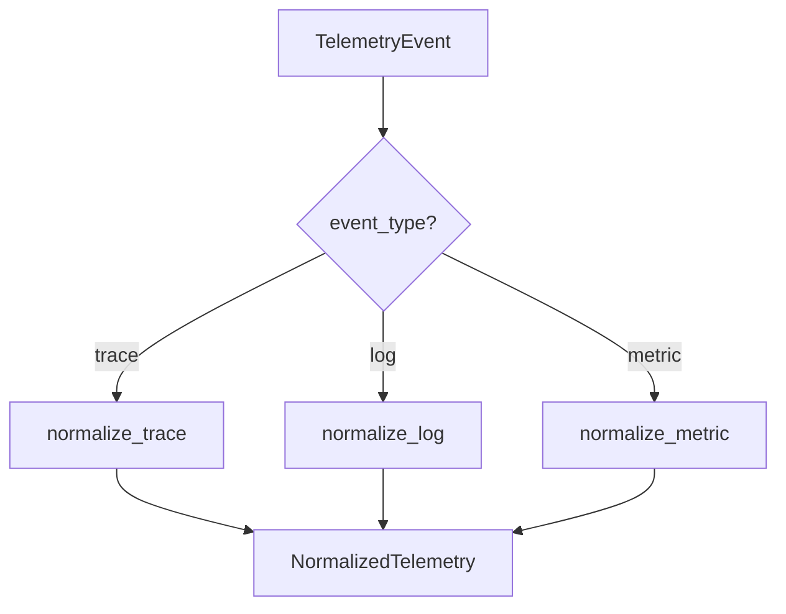

The service is intentionally a thin router — it contains no normalization logic of its own, only the decision of which normalizer to call — which keeps the architecture modular and makes it straightforward to add another telemetry type later.

```python
def normalize_event(event: TelemetryEvent) -> NormalizedTelemetry:
    """
    Normalize a telemetry event using the appropriate
    event-specific normalizer.
    """
    if event.event_type == "trace":
        return normalize_trace(event)
    if event.event_type == "log":
        return normalize_log(event)
    if event.event_type == "metric":
        return normalize_metric(event)
    raise ValueError(
        f"Unsupported telemetry event type: {event.event_type}"
    )
```

Callers now go through a single entry point, `normalize_event(event)`, rather than knowing about `normalize_trace`, `normalize_log`, and `normalize_metric` individually. Unsupported event types raise a clear error rather than failing silently.

```bash
pytest -q tests/test_trace_normalizer.py tests/test_log_normalizer.py tests/test_metric_normalizer.py tests/test_normalization_service.py tests/test_normalized_telemetry.py
```

**27 tests passed** — this confirmed that the normalized telemetry schema, trace normalization, log normalization, metric normalization, and the unified normalization service all work correctly together. This is the full normalization foundation, verified end to end:

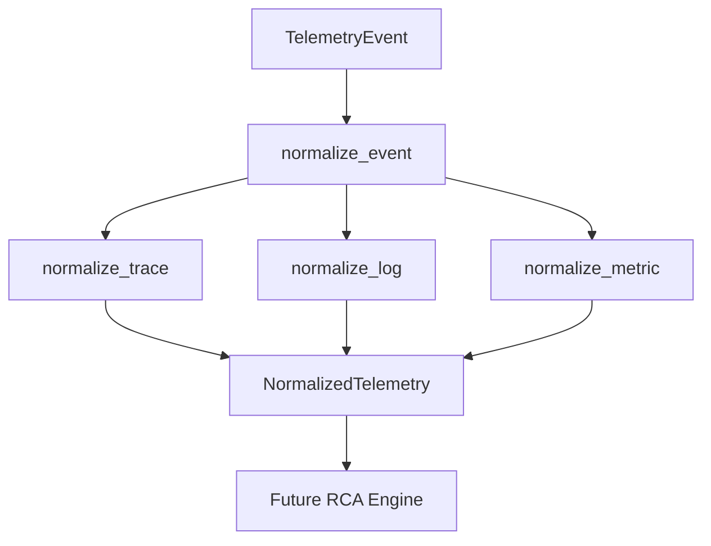

### Normalization Roadmap

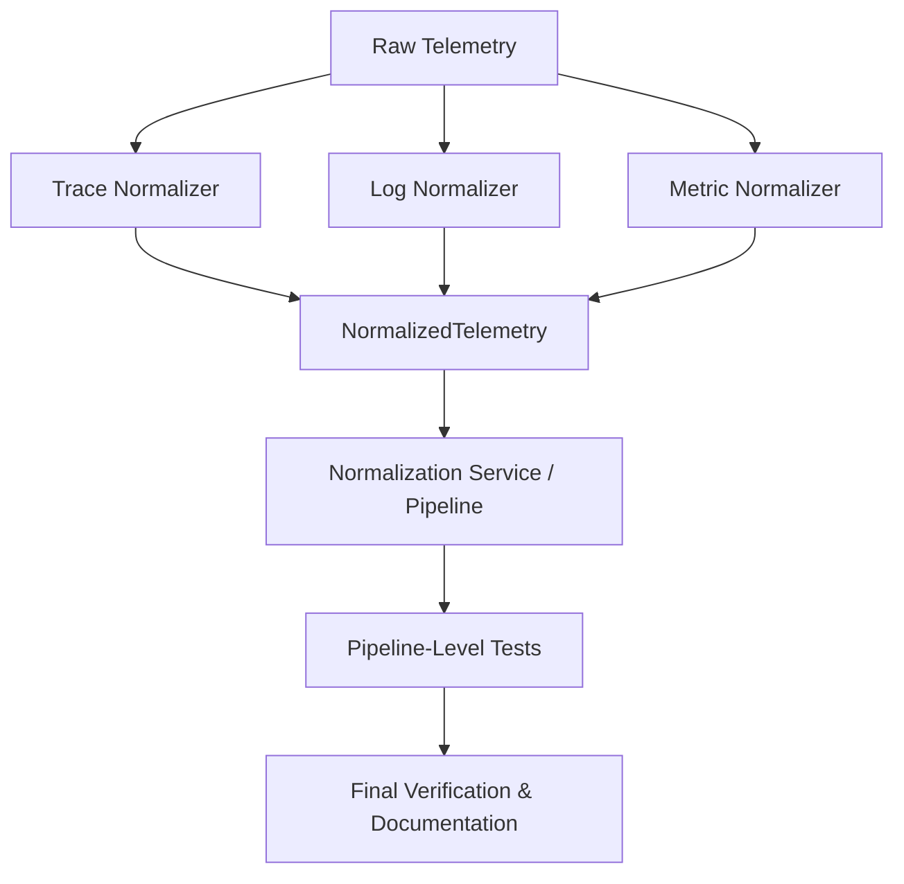

| Task | Status |
|---|---|
| Freeze normalization contract | ✅ Complete |
| Define normalized telemetry schema | ✅ Complete |
| Trace normalization | ✅ Complete |
| Log normalization | ✅ Complete |
| Metric normalization | ✅ Complete |
| Normalization service / pipeline | ✅ Complete |
| Pipeline-level normalization tests | ✅ Complete |
| Final verification & documentation closeout | ✅ Complete |

### Final Verification

```text
30 passed
```

The complete normalization test suite — common schema validation, trace normalization, log normalization, metric normalization, and the unified `normalize_event()` pipeline — passes together. Telemetry Normalization is fully complete:

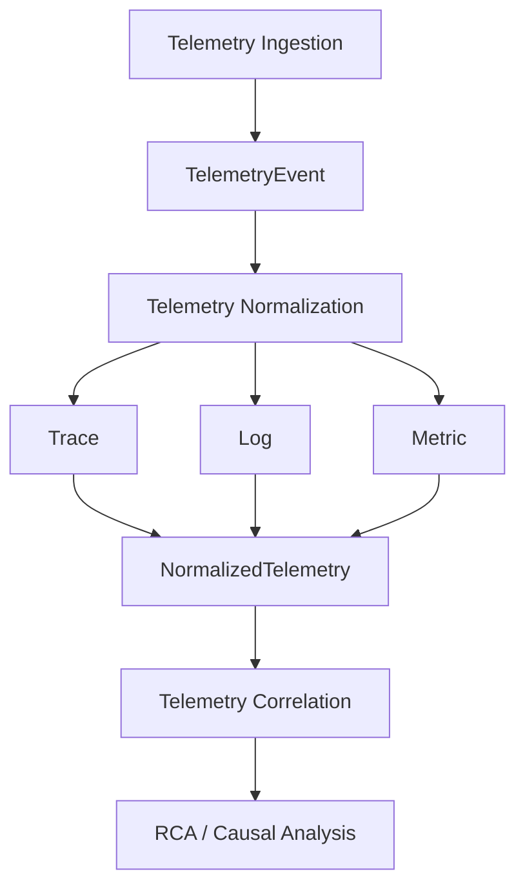

---

## Telemetry Correlation

**Status:** ✅ Complete

### Why Correlation Matters

A single incident can surface as several unrelated-looking telemetry events:

```text
10:00:01  Trace  → payment-service → process-payment → ERROR
10:00:01  Log    → payment-service → "Database timeout"
10:00:02  Metric → payment-service → CPU = 95%
```

These are three separate events, but they likely belong to the same incident. Normalization tells us what each event looks like; correlation tells us which events belong together.

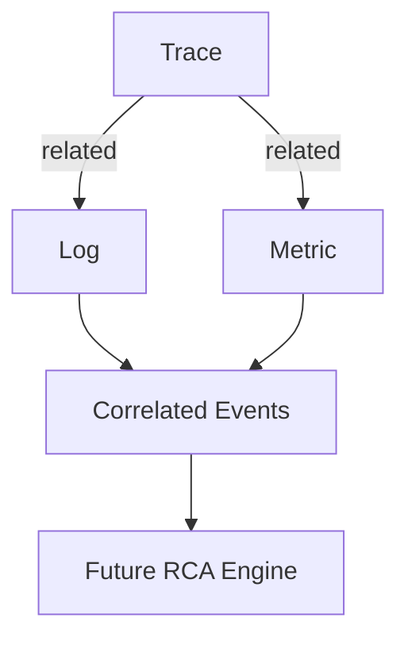

### Correlation Contract & Identifiers

Correlation is built on top of `NormalizedTelemetry`, using four of its fields as correlation identifiers:

| Identifier | Strength | Purpose |
|---|---|---|
| `trace_id` | 🟢 Strong | Same distributed request |
| `span_id` | 🟢 Strong | Same operation / span |
| `service_name` | 🟡 Medium | Same microservice |
| `timestamp` | 🟡 Medium | Events happened near each other |

`event_id` is used only to uniquely identify an event — it never establishes correlation on its own.

### Correlation Rules

Each pair of events is scored against a fixed set of rules rather than treated as a simple match/no-match:

| Match | Strength |
|---|---|
| Same `trace_id` + same `span_id` | `VERY_STRONG` |
| Same `trace_id` | `STRONG` |
| Same `service_name` + within 5 seconds | `MEDIUM` |
| No matching rule | No correlation |

Giving correlations a strength — rather than a boolean — matters because later causal analysis can weight stronger relationships more heavily than weaker ones.

Every match produces a `CorrelationResult` describing the relationship rather than modifying either event:

```text
Event A ──────── correlation ──────── Event B
                     │
                     ├─ type
                     ├─ strength
                     └─ reason
```

### Trace–Log Correlation

The first and strongest practical rule: a trace and a log are correlated when they share the same `trace_id`.

```text
Trace:  trace_id = abc123, service = payment-service, operation = process-payment, status = ERROR
Log:    trace_id = abc123, service = payment-service, message = "Database connection timeout"
```

These two events are correlated because they belong to the same trace. Test coverage includes: matching `trace_id` → `STRONG`; differing `trace_id` → no correlation; missing `trace_id` → no trace-ID correlation.

### Trace–Metric Correlation

A metric doesn't carry a `trace_id`, so trace–metric correlation instead uses the service + time rule:

```text
trace.service_name == metric.service_name
AND
|trace.timestamp - metric.timestamp| <= 5 seconds
```

```text
Trace:   service = payment-service, time = 10:00:01
Metric:  service = payment-service, time = 10:00:04, CPU = 95%
```

A 3-second gap on the same service → `MEDIUM` correlation. Events on different services, or more than 5 seconds apart, are not correlated by this rule. No schema changes were needed — `service_name`, `timestamp`, and `event_id` on `NormalizedTelemetry` are sufficient.

### Time / Service-Based Correlation

The service + time rule was generalized into a single reusable function rather than being specific to trace–metric pairs:

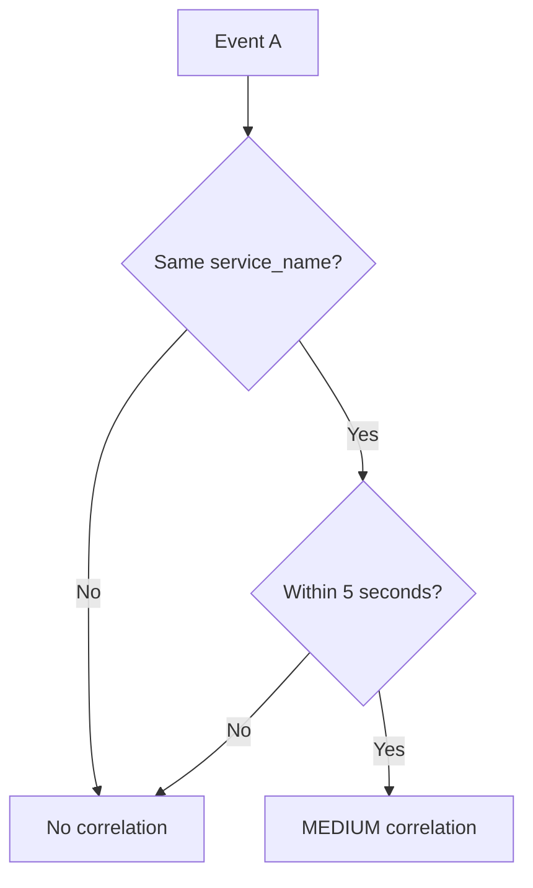

This single function now covers trace↔log, trace↔metric, log↔metric, and metric↔metric pairs — anywhere two events share a service and occur within 5 seconds of each other.

### Unified Correlation Service / Pipeline

With trace–log, trace–metric, and generic service/time correlation implemented separately, a single entry point was added on top of them:

```python
def correlate_events(
    events: list[NormalizedTelemetry],
) -> list[CorrelationResult]:
    ...
```

It takes a list of normalized telemetry events and returns every valid correlation among them, applying the rules in order of strength:

| Situation | Rule | Strength |
|---|---|---|
| Trace + Log, same `trace_id` | Trace-ID match | `STRONG` |
| Trace + Metric | Same service + ≤ 5 sec | `MEDIUM` |
| Any compatible events | Same service + ≤ 5 sec | `MEDIUM` |

The service never modifies the telemetry events it's given — it only produces relationships between them:

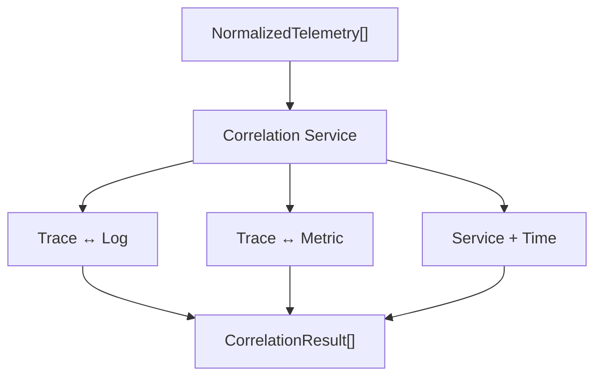

### Correlation Roadmap

| Task | Status |
|---|---|
| Inspect normalized telemetry and freeze correlation contract | ✅ Complete |
| Define correlation identifiers and matching rules | ✅ Complete |
| Trace–log correlation | ✅ Complete |
| Trace–metric correlation | ✅ Complete |
| Time / service-based correlation | ✅ Complete |
| Unified correlation service / pipeline | ✅ Complete |
| Correlation tests, final verification & documentation closeout | ✅ Complete |

### Final Verification

```text
23 passed
```

This confirmed trace–log correlation via `trace_id` (and the stronger `trace_id` + `span_id` match), trace–metric correlation via service and time proximity, the generic service/time rule, and the unified correlation service all work correctly together.

---

## Service Topology + Neo4j

**Status:** ✅ Complete

Transforms relationships observed in normalized telemetry into a persistent service dependency graph in Neo4j. The topology layer provides the structural context required by later RCA, Graph RAG, blast-radius analysis, and dashboard visualization.

### Why Service Topology Matters

Distributed systems contain multiple services that communicate with each other:

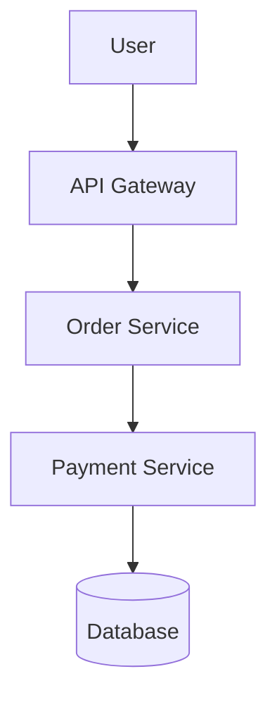

When an incident occurs, knowing that a service is failing is not enough. TraceRCA must also understand which services depend on it, which services it depends on, how failures can propagate, and which services may be affected by an incident. The service topology provides this structural context.

### Topology Architecture

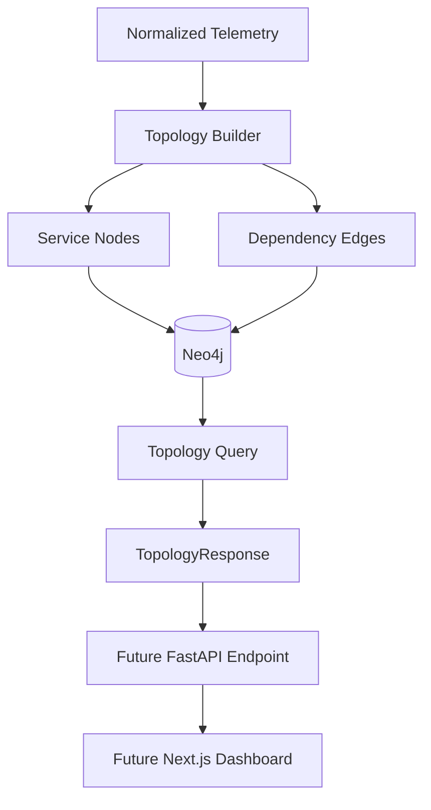

The topology layer sits between normalized telemetry and the future RCA / dashboard layers.

### Topology Contract

Two primary graph entities were defined.

**Service Node** — every unique service becomes a node:

```text
Service
├── service_name
├── first_seen
├── last_seen
└── attributes
```

**Dependency Edge** — a relationship between two services:

```text
Source Service
      │
      │ DEPENDS_ON
      ▼
Target Service
```

Dependencies are derived from parent/child service relationships observed within a trace, not from events simply occurring near each other in time:

```text
Trace
│
├── api-gateway   (parent span)
│
└── payment-service (child span)
```

becomes:

```text
api-gateway
      │
      ▼
payment-service
```

This is represented in Neo4j as:

```text
(:Service)-[:DEPENDS_ON]->(:Service)
```

### Topology Construction Rules

| Situation | Result |
|---|---|
| Same service observed repeatedly | Reuse the same `Service` node |
| Different services connected through a valid trace/span relationship | Create a dependency edge |
| Same dependency observed repeatedly | Reuse/update the existing edge |
| Same service as source and target | Reject self-dependency |
| Services only close in time | Do not create a dependency |
| Insufficient relationship information | Do not invent a dependency |

A particularly important design rule: **TraceRCA must not infer a service dependency merely because two services generated telemetry near each other in time.** Topology dependencies require structural evidence from the trace/span relationship.

### Topology Schemas

Two Pydantic models represent the topology.

**`ServiceNode`**

```python
ServiceNode(
    service_name="payment-service",
    first_seen=...,
    last_seen=...,
)
```

Validation ensures `service_name` is not empty, whitespace-only names are rejected, and service names have a maximum length of 255 characters.

**`DependencyEdge`**

```python
DependencyEdge(
    source_service="api-gateway",
    target_service="payment-service",
    first_seen=...,
    last_seen=...,
)
```

Validation ensures the source and target services are each valid, and that source and target cannot be the same service (no `payment-service → payment-service` self-dependency).

**`TopologyResponse`**

```python
TopologyResponse(
    services=[...],
    dependencies=[...],
)
```

`ServiceNode` maps onto a Neo4j node and `DependencyEdge` onto a Neo4j relationship, which is why they are kept as separate models. `TopologyResponse` gives downstream consumers a single representation of the complete service graph.

### Neo4j Infrastructure

Neo4j was added as the graph database for the service topology, running in a Docker container named `tracerca-neo4j`:

| Interface | Address |
|---|---|
| Browser | `localhost:7474` |
| Bolt | `localhost:7687` |

The Neo4j data directory uses a persistent Docker volume, so stopping the container does not remove the stored graph data. Connectivity was verified using the Neo4j Browser and a Bolt connection.

### Neo4j Connection Layer

A dedicated asynchronous Neo4j connection layer was implemented at `backend/app/db/neo4j.py`, using the official Neo4j Python driver to provide asynchronous driver creation, connectivity verification, and connection cleanup.

Configuration lives in `backend/app/core/config.py` and is supplied through environment variables rather than hard-coded credentials. The local `.env` file stays ignored by Git so credentials are never committed to the repository.

### Service-Node Creation / Upsert

Implemented in `backend/app/telemetry/topology_service.py` using Neo4j `MERGE` for idempotent service creation:

```cypher
MERGE (s:Service {
    service_name: $service_name
})
```

If a service doesn't exist, a new node is created:

```text
(:Service {
    service_name: "payment-service",
    first_seen: ...,
    last_seen: ...
})
```

If it already exists, the existing node is reused: `first_seen` is preserved as the earliest observation and `last_seen` is updated to the latest one — so repeated observations never create duplicate service nodes.

### Dependency-Edge Creation / Upsert

Dependency relationships are represented as `(:Service)-[:DEPENDS_ON]->(:Service)` and also use Neo4j `MERGE`:

```text
api-gateway
     │
     │ DEPENDS_ON
     ▼
payment-service
```

The relationship stores `first_seen` and `last_seen`. Repeated observations of the same source and target update the existing relationship rather than creating duplicate edges, and both service nodes must already exist before a dependency relationship is created between them.

```bash
pytest -q tests/test_topology_service.py
```

**1 passed** — confirms Neo4j actually creates a `test-api-service → DEPENDS_ON → test-database-service` relationship, i.e. TraceRCA can create two `Service` nodes, create a `DEPENDS_ON` relationship between them, store `first_seen`/`last_seen`, and use `MERGE` to prevent duplicate dependency edges against a real Neo4j database.

### Topology Construction Pipeline

Implemented in `backend/app/telemetry/topology_builder.py`, which accepts `NormalizedTelemetry` and builds the graph from it:

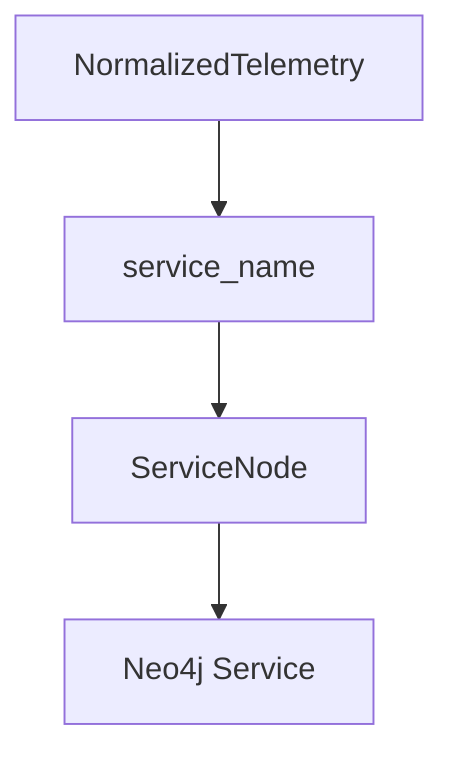

Trace parent/child relationships are also converted into service dependencies:

```text
Parent Span
api-gateway
     ↓
Child Span
payment-service
```

becomes:

```text
api-gateway
     │
     │ DEPENDS_ON
     ▼
payment-service
```

The builder does **not** create a dependency when either service name is missing, the events are not trace events, or both spans belong to the same service — ensuring topology relationships are based on meaningful trace structure rather than simple temporal proximity.

### Topology Query / Retrieval

`get_topology()` retrieves two categories of information from Neo4j:

| Category | Fields |
|---|---|
| Services | `service_name`, `first_seen`, `last_seen` |
| Dependencies | `source_service`, `target_service`, `first_seen`, `last_seen` |

```cypher
MATCH (s:Service)
RETURN s.service_name, s.first_seen, s.last_seen
```

```cypher
MATCH (source:Service)-[d:DEPENDS_ON]->(target:Service)
RETURN source.service_name, target.service_name, d.first_seen, d.last_seen
```

The result is returned as a `TopologyResponse`:

```json
{
  "services": [
    { "service_name": "payment-service", "first_seen": "...", "last_seen": "..." }
  ],
  "dependencies": [
    { "source_service": "payment-service", "target_service": "order-service", "first_seen": "...", "last_seen": "..." }
  ]
}
```

This creates a clean boundary between the Neo4j graph representation and future API/dashboard consumers.

### Dashboard Integration Direction

The topology retrieval structure was intentionally designed for the future TraceRCA dashboard:

```mermaid
flowchart LR
    N4J[(Neo4j)] --> GT[get_topology]
    GT --> TR[TopologyResponse]
    TR --> API[FastAPI]
    API --> DASH[Next.js Dashboard]
    DASH --> VIZ[Graph Visualization]
```

The dashboard will eventually visualize chains such as `Frontend → API → Order Service → Payment Service → Database` without the frontend needing to understand Neo4j or Cypher.

### Topology Testing & Verification

Dedicated topology tests were added:

- `tests/test_topology.py`
- `tests/test_topology_service.py`

Coverage includes: `ServiceNode` creation and validation, `DependencyEdge` creation and self-dependency validation, Neo4j service-node upsert, Neo4j dependency-edge upsert, topology construction, topology retrieval, and complete topology integration.

```bash
pytest -q tests/test_topology.py tests/test_topology_service.py
```

**11 tests passed.**

A full regression run was then executed across the entire project:

```bash
pytest -q
```

**92 passed, 6 warnings** — confirming the new Neo4j/topology functionality did not break existing telemetry ingestion, normalization, correlation, or other project functionality. The warnings were dependency deprecation warnings, not test failures.

```mermaid
flowchart TD
    OT[OpenTelemetry] --> ING[Telemetry Ingestion]
    ING --> NORM[Normalization]
    NORM --> CORR[Correlation]
    CORR --> TB[Topology Builder]
    TB --> SN[Service Nodes]
    TB --> DE[Dependency Edges]
    SN --> N4J[(Neo4j)]
    DE --> N4J
    N4J --> TR[TopologyResponse]
    TR --> RCA[Future RCA Engine]
    TR --> DASH[Future Dashboard]
```

Service topology completes the structural foundation required by the later RCA and Graph RAG layers.

### Topology Roadmap

| Task | Status |
|---|---|
| Inspect correlation output and define topology contract | ✅ Complete |
| Define service-node and dependency-edge schemas | ✅ Complete |
| Set up Neo4j infrastructure | ✅ Complete |
| Configure Neo4j connection layer | ✅ Complete |
| Implement service-node creation/upsert | ✅ Complete |
| Implement dependency-edge creation/upsert | ✅ Complete |
| Build topology construction service/pipeline | ✅ Complete |
| Add topology query/retrieval | ✅ Complete |
| Add topology tests + integration verification | ✅ Complete |
| Final verification + documentation closeout | ✅ Complete |

---

## Basic Anomaly Detection

**Status:** ✅ Complete

Completes the final layer of the Part 1 Observability Foundation by detecting abnormal behavior across latency, error rates, and telemetry metrics.

### Anomaly Detection Objective

The anomaly detection layer compares observed telemetry behavior against an expected baseline:

```text
Observed Telemetry
        ↓
Expected Baseline
        ↓
Deviation Calculation
        ↓
Threshold Evaluation
        ↓
Anomaly
```

An anomaly is defined as a telemetry observation whose behavior significantly deviates from the expected behavior of a service. The initial implementation deliberately uses simple, explainable threshold-based detection rather than machine-learning-based anomaly detection — this keeps the system explainable, which matters later when anomaly detection feeds into RCA:

```mermaid
flowchart TD
    OB[Observed behavior] --> CMP[Compare with baseline]
    CMP --> DEV[Calculate deviation]
    DEV --> THR[Apply threshold]
    THR --> Q{Anomaly?}
    Q -- Yes --> A[Anomaly]
    Q -- No --> N[Normal]
```

Three anomaly types are detected:

| Anomaly | Example |
|---|---|
| Latency anomaly | A service normally responds in 100 ms but suddenly takes 900 ms |
| Error-rate anomaly | A service normally has 1% errors but suddenly reaches 30% |
| Metric anomaly | CPU normally stays around 40% but suddenly reaches 95% |

### Anomaly Contract

Every detected anomaly contains:

| Field | Purpose |
|---|---|
| `anomaly_id` | Unique anomaly identifier |
| `service_name` | Service where the anomaly occurred |
| `anomaly_type` | `LATENCY`, `ERROR_RATE`, or `METRIC` |
| `timestamp` | Time of the detected anomaly |
| `observed_value` | Actual observed value |
| `expected_value` | Expected baseline value |
| `severity` | `LOW`, `MEDIUM`, or `HIGH` |
| `description` | Human-readable explanation |

### Latency Anomaly Detection

Latency anomalies compare observed trace duration against an expected latency baseline:

```text
deviation = |observed - expected| / expected
```

| Deviation | Severity |
|---|---|
| < 50% | Normal |
| 50% – <100% | LOW |
| 100% – <200% | MEDIUM |
| ≥ 200% | HIGH |

```text
Expected = 100 ms, Observed = 180 ms, Deviation = 80%   → LOW
Expected = 100 ms, Observed = 250 ms, Deviation = 150%  → MEDIUM
Expected = 100 ms, Observed = 350 ms, Deviation = 250%  → HIGH
```

Invalid values such as a zero expected latency (which would require dividing by zero) or a negative observed latency are rejected.

### Error-Rate Anomaly Detection

Error-rate anomalies compare the observed error rate against the expected error-rate baseline, using percentage-point deviation rather than relative deviation:

```text
deviation = |observed_error_rate - expected_error_rate|
```

| Deviation | Severity |
|---|---|
| < 5 percentage points | Normal |
| 5 – <10 | LOW |
| 10 – <20 | MEDIUM |
| ≥ 20 | HIGH |

```text
Expected error rate = 2%, Observed = 15%  → deviation = 13 points → MEDIUM
Expected error rate = 2%, Observed = 4%   → deviation = 2 points  → Normal
```

Observed and expected error rates must be between 0 and 100.

### Metric Anomaly Detection

Metric anomalies use relative deviation from an expected baseline and apply to numeric metrics such as CPU utilization, memory usage, request counts, and similar telemetry values:

```text
deviation = |observed - expected| / |expected|
```

| Deviation | Severity |
|---|---|
| < 50% | Normal |
| 50% – <100% | LOW |
| 100% – <200% | MEDIUM |
| ≥ 200% | HIGH |

```text
Expected CPU = 40, Observed CPU = 100, Deviation = 150% → MEDIUM
```

A zero expected metric value is rejected, since relative deviation cannot be calculated against it.

### Unified Anomaly Detection Service

The three detectors are exposed through a single service:

```mermaid
flowchart TD
    NT[Normalized Telemetry] --> SVC[AnomalyDetectionService]
    SVC --> LD[Latency Detector]
    SVC --> ED[Error-Rate Detector]
    SVC --> MD[Metric Detector]
    LD --> A[Anomaly]
    ED --> A
    MD --> A
```

This gives the anomaly-detection layer one consistent entry point and prepares its output for the later RCA pipeline. It was implemented alongside the three detectors in:

```text
backend/app/telemetry/
├── anomaly.py
├── anomaly_detector.py
└── anomaly_service.py
```

### Anomaly Detection Testing & Verification

```bash
pytest -q tests/test_anomaly_detection.py
```

**19 tests passed**, covering: normal latency behavior; low, medium, and high latency anomalies; invalid latency values; normal error-rate behavior; low, medium, and high error-rate anomalies; invalid error-rate values; normal metric behavior; low, medium, and high metric anomalies; invalid metric values; and the unified anomaly detection service.

A full regression run was then executed across the entire project:

```bash
pytest -q
```

**111 passed, 6 warnings** — the warnings are dependency/deprecation warnings and did not cause test failures.

### Part 1 Final Output

With anomaly detection complete, the Part 1 observability pipeline is:

```mermaid
flowchart TD
    OT[OpenTelemetry] --> ING[Telemetry Ingestion]
    ING --> NORM[Telemetry Normalization]
    NORM --> CORR[Telemetry Correlation]
    CORR --> TOPO[Service Topology]
    TOPO --> N4J[(Neo4j)]
    N4J --> ANOM[Anomaly Detection]
    ANOM --> EV[Anomaly Evidence]
```

Part 1 now provides the structured observability foundation required by the AI Root Cause Intelligence layer in Part 2.

### Anomaly Detection Roadmap

| Task | Status |
|---|---|
| Inspect topology output and freeze anomaly contract | ✅ Complete |
| Define anomaly schema | ✅ Complete |
| Implement latency anomaly detection | ✅ Complete |
| Implement error-rate anomaly detection | ✅ Complete |
| Implement metric anomaly detection | ✅ Complete |
| Build unified anomaly detection service | ✅ Complete |
| Add anomaly detection tests | ✅ Complete |
| Final verification & documentation closeout | ✅ Complete |

---

## Dashboard

**Status:** 🔄 In progress

With Part 1's observability foundation complete, a dashboard is being added so the ingested, normalized, correlated, topology, and anomaly data can actually be seen and explored. The dashboard reuses Part 1's existing services rather than duplicating their logic or introducing fake data.

### Dashboard Data Flow & Architecture

```mermaid
flowchart TD
    T[Test Microservices] --> OT[OpenTelemetry]
    OT --> P1["TraceRCA Part 1 (Ingestion → Normalization → Correlation → Topology → Anomaly Detection)"]
    P1 --> PG[(PostgreSQL / Redis)]
    P1 --> N4J[(Neo4j)]
    PG --> API[FastAPI Dashboard APIs]
    N4J --> API
    API --> UI[Next.js Dashboard]
```

A firm rule governs this flow: the Next.js frontend never talks directly to PostgreSQL, Redis, or Neo4j. Everything goes through FastAPI:

```mermaid
flowchart LR
    UI[Next.js] --> API[FastAPI]
    API --> SVC[TraceRCA Data Layer]
    SVC --> DB[(PostgreSQL / Redis / Neo4j)]
```

### Architecture Layers

| Layer | Responsibility |
|---|---|
| **Presentation** — Next.js | Dashboard, Traces, Logs, Metrics, Topology, Anomalies, Service pages |
| **API** — FastAPI | Dashboard endpoints, request validation, response schemas |
| **TraceRCA Services** | Telemetry, normalization, correlation, topology, anomaly detection (all from Part 1) |
| **Data** | PostgreSQL, Redis, Neo4j |

```mermaid
flowchart TD
    UI[Next.js] --> RTR[Dashboard API Router]
    RTR --> SVC[Dashboard Service]
    SVC --> PG[(PostgreSQL)]
    SVC --> N4J[(Neo4j)]
    SVC --> ANOM[M9 Anomaly Results]
```

### Design Principles

- The frontend never accesses PostgreSQL, Redis, or Neo4j directly — only through FastAPI.
- The dashboard does not duplicate or change Part 1 logic; it adds a thin **Dashboard Router** and **Dashboard Service** on top of it.
- No endpoint returns hard-coded or fake data — each one is mapped to a real, existing Part 1 source before it's built.
- A query/repository layer for dashboard-style reads didn't previously exist (ingestion and normalization only wrote and transformed `TelemetryEvent`, never queried it back), so a small read-only dashboard service layer was introduced rather than placing SQL queries directly in the API routes.

### Storage Responsibilities

| Storage | Dashboard responsibility |
|---|---|
| PostgreSQL | Persistent telemetry/event information |
| Redis | Fast/temporary data and caching where already used |
| Neo4j | Service topology and dependency relationships |

The dashboard does not introduce another database.

### Dashboard Sections → Data Source

| Dashboard section | Source |
|---|---|
| Overview statistics | TraceRCA backend/storage (aggregated) |
| Traces | Normalized trace telemetry |
| Logs | Normalized log telemetry |
| Metrics | Normalized metric telemetry |
| Topology | Topology service → Neo4j |
| Anomalies | Anomaly detection output |
| Service details | Combination of existing telemetry, topology, and anomaly data |
| Trace details | Trace/span data |
| Root Cause | Part 2 — placeholder |
| Auto-Healing | Part 3 — placeholder |

### Dashboard API Contracts

| Endpoint | Purpose | Real source |
|---|---|---|
| `GET /dashboard/overview` | Overall system summary | PostgreSQL + topology + anomaly results |
| `GET /dashboard/services` | List monitored services | PostgreSQL / topology |
| `GET /dashboard/topology` | Service dependency graph | Neo4j / `TopologyService` |
| `GET /dashboard/traces` | Trace events | `TelemetryEvent` |
| `GET /dashboard/logs` | Log events | `TelemetryEvent` |
| `GET /dashboard/metrics` | Metric events | `TelemetryEvent` |
| `GET /dashboard/anomalies` | Detected anomalies | Anomaly detection output |
| `GET /dashboard/services/{service_name}` | Service investigation | Combined existing data |

Representative response shapes:

```json
// GET /dashboard/traces
{
  "items": [
    {
      "trace_id": "...", "span_id": "...", "parent_span_id": "...",
      "service_name": "...", "operation_name": "...", "timestamp": "...",
      "duration_ms": 120.5, "status": "OK"
    }
  ]
}
```

```json
// GET /dashboard/logs
{
  "items": [
    { "timestamp": "...", "service_name": "...", "message": "...", "trace_id": "...", "span_id": "..." }
  ]
}
```

```json
// GET /dashboard/metrics
{
  "items": [
    { "timestamp": "...", "service_name": "...", "metric_name": "...", "metric_value": 42.5 }
  ]
}
```

```json
// GET /dashboard/anomalies
{
  "items": [
    {
      "anomaly_id": "...", "service_name": "payment-service", "anomaly_type": "LATENCY",
      "timestamp": "...", "observed_value": 800, "expected_value": 100,
      "severity": "HIGH", "description": "..."
    }
  ]
}
```

`/dashboard/topology` reuses the existing `TopologyResponse` (`services` + `dependencies`) rather than inventing a second topology structure. A few deliberate omissions and open items from this contract:

- `/dashboard/logs` does not include a `level` field, since the current log schema doesn't guarantee one.
- The retrieval/persistence mechanism behind `/dashboard/anomalies` isn't finalized yet — anomaly detection exists but isn't currently wired into an application flow that persists its results, so this is marked as an open item for end-to-end integration rather than papered over with a fake table.
- Telemetry endpoints are planned to eventually support `service_name`, `start_time`, `end_time`, `limit`, and `offset` query parameters (e.g. `GET /dashboard/traces?service_name=payment-service`), added once the basic real-data endpoints are in place.

### Frontend Structure

```text
Next.js
│
├── App Layout
│   ├── Sidebar
│   ├── Topbar
│   └── Main Content
│
├── Dashboard
├── Traces
├── Logs
├── Metrics
├── Topology
├── Anomalies
├── Root Cause
├── Auto-Healing
├── Alerts
└── Settings
```

### Demo Microservice

A small demo microservice generates synthetic traces, logs, and metrics (including parent-child span relationships) against the Telemetry Ingestion API, so the dashboard — topology in particular — can be verified against real, flowing telemetry rather than fixtures.

```bash
cd demo-microservice
.\.venv\Scripts\Activate.ps1
uvicorn main:app --reload --port 8001
```

### Dashboard Roadmap

| Task | Status |
|---|---|
| Freeze dashboard requirements | ✅ Complete |
| Define dashboard architecture | ✅ Complete |
| Define API contracts | ✅ Complete |
| Define frontend pages/components | ✅ Complete |
| Dashboard backend APIs | 🔄 In progress — topology endpoint verified end to end |
| Next.js dashboard | 🔄 In progress — topology view verified |
| Test microservices | ✅ Complete — demo microservice producing synthetic telemetry |
| End-to-end integration | 🔄 In progress — topology verified; full pipeline not yet verified |
| Dashboard polish | ⏳ Planned |

---

## Part 1 Final Verification

**Status:** ✅ Complete

All of Part 1's observability layers — telemetry ingestion, normalization, correlation, service topology, and basic anomaly detection — are implemented and verified together.

### Final Test Results

| Verification | Result |
|---|---|
| Complete project test suite | 112 passed |
| Focused ingestion and topology tests | 18 passed |
| Dashboard topology integration | Verified visually |
| Neo4j service and dependency graph | Verified |
| Repeated service-node upsert regression test | Passed |

### Verified Dashboard Topology

The dashboard successfully displays three services — `api-gateway`, `demo-payment-service`, `payment-service` — and two observed dependencies: `api-gateway → demo-payment-service` and `api-gateway → payment-service`. The dependency between `api-gateway` and `demo-payment-service` was verified using synthetic parent-child trace spans submitted by the demo microservice.

### Verified Data Flow

```mermaid
flowchart TD
    DM[Demo Microservice] --> ST[Synthetic Traces, Logs, Metrics]
    ST --> ING[Telemetry Ingestion API]
    ING --> PG[(PostgreSQL Persistence)]
    PG --> NORM[Telemetry Normalization]
    NORM --> TOPO[Service Topology Construction]
    TOPO --> N4J[(Neo4j Service Dependency Graph)]
    N4J --> API[FastAPI Dashboard Endpoint]
    API --> UI[Next.js Dashboard]
```

### Known Limitations

- The demo microservice currently generates synthetic parent-child span relationships. Automatic distributed tracing across real HTTP calls between independently running services has not yet been fully verified.
- The topology verification confirms dependency discovery and visualization; it does not establish that the complete root-cause analysis pipeline works end to end.
- Basic anomaly detection is implemented, but its integration into a complete incident investigation workflow remains future work.
- Graph RAG, advanced causal inference, evidence-based root-cause analysis, and blast-radius analysis belong to Part 2.
- Remediation recommendations, controlled auto-healing, and production hardening belong to Part 3.

### Next Development Phase

**Part 2 — AI Root Cause Intelligence**

The next phase builds on the completed observability foundation to connect correlated telemetry, service dependencies, temporal evidence, and causal inference into an explainable root-cause analysis workflow.

---

## Project Structure

```text
TraceRCA-AI/
├── backend/
│   ├── __init__.py
│   ├── app/
│   │   ├── __init__.py
│   │   ├── main.py
│   │   ├── api/
│   │   │   └── routes/
│   │   │       └── health.py
│   │   ├── cache/
│   │   │   ├── dependencies.py
│   │   │   └── redis_client.py
│   │   ├── core/
│   │   │   └── config.py
│   │   ├── dashboard/
│   │   │   ├── router.py
│   │   │   └── service.py
│   │   ├── db/
│   │   │   ├── base.py
│   │   │   ├── database.py
│   │   │   ├── models.py
│   │   │   └── neo4j.py
│   │   └── telemetry/
│   │       ├── models.py
│   │       ├── tracing.py
│   │       ├── schemas.py
│   │       ├── service.py
│   │       ├── normalized.py
│   │       ├── normalizers.py
│   │       ├── correlation.py
│   │       ├── correlation_service.py
│   │       ├── topology.py
│   │       ├── topology_service.py
│   │       ├── topology_builder.py
│   │       ├── anomaly.py
│   │       ├── anomaly_detector.py
│   │       └── anomaly_service.py
│   └── alembic/
│       ├── env.py
│       └── versions/
├── demo-microservice/
│   └── main.py
├── frontend/              # Next.js dashboard (Dashboard, Traces, Logs,
│                           # Metrics, Topology, Anomalies, Root Cause,
│                           # Auto-Healing, Alerts, Settings)
├── tests/
│   ├── test_health.py
│   ├── test_database_connection.py
│   ├── test_redis.py
│   ├── test_tracing.py
│   ├── test_telemetry_models.py
│   ├── test_ingestion_service.py
│   ├── test_telemetry_api.py
│   ├── test_telemetry_integration.py
│   ├── test_normalized_telemetry.py
│   ├── test_trace_normalizer.py
│   ├── test_log_normalizer.py
│   ├── test_metric_normalizer.py
│   ├── test_normalization_service.py
│   ├── test_correlation.py
│   ├── test_topology.py
│   ├── test_topology_service.py
│   └── test_anomaly_detection.py
├── docs/
├── scripts/
├── .env.example
├── .gitignore
├── alembic.ini
├── pyproject.toml
├── requirements.txt
└── README.md
```

---

## Getting Started

> **Prerequisites:** Python, PostgreSQL, Redis, Docker (for Neo4j).

```bash
# 1. Install dependencies
pip install -r requirements.txt

# 2. Configure environment variables
cp .env.example .env

# 3. Apply database migrations
alembic upgrade head

# 4. Start Neo4j (service topology)
docker start tracerca-neo4j
# Browser: http://localhost:7474   Bolt: localhost:7687

# 5. Run the API
uvicorn backend.app.main:app --reload
```

### Running the Demo Microservice (optional)

To exercise the dashboard with real, flowing telemetry instead of fixtures, run the demo microservice in a second terminal:

```powershell
cd demo-microservice
.\.venv\Scripts\Activate.ps1
uvicorn main:app --reload --port 8001
```

### Troubleshooting (Windows)

If `docker` commands aren't recognized in PowerShell, add Docker to the `PATH` for the current session:

```powershell
$env:Path += ";C:\Program Files\Docker\Docker\resources\bin"
```

## Testing

```bash
# Run the full test suite
pytest -q

# Run the telemetry ingestion tests
pytest -q tests/test_ingestion_service.py tests/test_telemetry_api.py

# Run the OpenTelemetry integration test
pytest -q tests/test_ingestion_service.py tests/test_telemetry_integration.py

# Run the normalization tests
pytest -q tests/test_normalized_telemetry.py tests/test_trace_normalizer.py tests/test_log_normalizer.py tests/test_metric_normalizer.py tests/test_normalization_service.py

# Run the correlation tests
pytest -q tests/test_correlation.py

# Run the topology tests
pytest -q tests/test_topology.py tests/test_topology_service.py

# Run the anomaly detection tests
pytest -q tests/test_anomaly_detection.py
```